# Project 3

## Fun with Diffusion Models

Diffusion is pretty cool. It's an approach to generative AI used by the likes of DALL-E and Imagen, popular image creation tools. In this project I trained a simple diffusion model, and then used a (better) pre-trained diffusion model to make some cool images. My hope in this writeup is to explain how it works.

**Key Idea**: Images are represented by a computer by lists of numbers, and there are *a lot* of lists of numbers, but not all of them represent *real* images.

Each number answers a question like "how much of this color is in this pixel?" If we have, say, a $512$-square-pixel image, each pixel has three color channels, and each color has $256$ possible intensities, there are $512 \times 512 \times 3 \times 256$ (about $200$ million) possible images!

  <figure>
    
    <figcaption>real image</figcaption>
  </figure>
  <figure>
    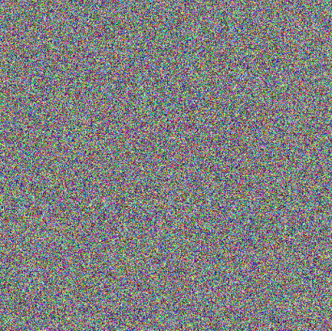
    <figcaption>noise</figcaption>
  </figure>

Some of them look like real images (left), but most of them do not (right). You could in theory generate random images until you find something you like (monkeys writing shakespeare), but you'd have to wait a very long time. 

**Key Idea**: We want to make a computer "learn" what real images look like. A perhaps reductionist but nontheless insightful interpretation is this picture: 

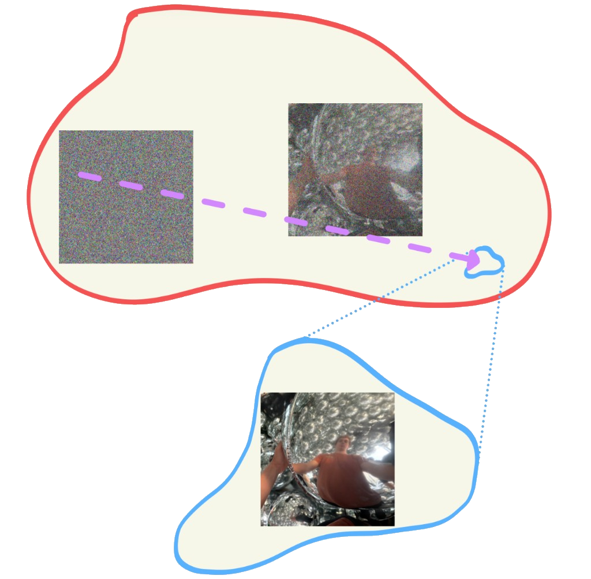

All of these $200$ million images live inside some super high dimensional space (red).  Perhaps the "real" images all live in a tiny sliver of that huge $200$ million image space (blue). In a sense, diffusion figures out out *where that tiny sliver is,* and then generates *new* images that *come from that tiny sliver*.

### Visualizing Training and Sampling

See the purple arrow above. In theory, *this* is what we want a computer to learn; namely, how to turn a not-real image into a real one. How can we do that?

**Key Idea**: It is easier to make a real image noisy than a noisy image real. Hence, we will "noise up" a real image, show a neural net the noise, and make it figure out what it needs to do to turn that noise back into a real image. Later, when we want to generate new images, we can generate new noise and let the neural network turn it "back" into a real image.

In particular, we will consider exactly the path between some randomly generated noise and a sampled image (purple). That path is described by 

\[
x_t = (1 - t)x_0 + tx_1, \qquad t \in [0, 1].
\]
The ideal "velocity," i.e. the change in image $dx_t$ over a small change in $t$, that would take a point at $x_t$ to $x_1$ is exactly $x_1 - x_0$. The model will try to predict
\[
\frac{dx_t}{dt} = v_\theta(x_t, t, c)
\]
by minimizing the loss function
\[
\mathcal{L}(\theta) = \mathbb{E}\left[\lVert v_\theta(x_t, t, c) - (x_1 - x_0) \rVert^2\right]
\]
which encourages the predicted velocity $v_\theta$ to be as close as possible to $x_1 - x_0$. Let's visualize this process!

### Constructing Noisy Training Inputs

These are some inputs a neural network might see during training. It will try to predict how to remove some of that noise to push the image it sees closer to a "real" image $x_1$.

  <figure>
    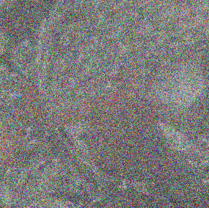
    <figcaption>$x_{0.25}$</figcaption>
  </figure>
  <figure>
    
    <figcaption>$x_{0.5}$</figcaption>
  </figure>
  <figure>
    
    <figcaption>$x_{0.75}$</figcaption>
  </figure>
  <figure>
    
    <figcaption>$x_1$</figcaption>
  </figure>

### Classical Denoising

A classical denoising approach is to simply blur the noised image. The intuition is that, as long as *most* of the noised image is still "real," the blur will spread around that "realness" and obsfucate the noise. As the images below demonstrate, this works OK for small noise (i.e. large $t$).

  <figure>
    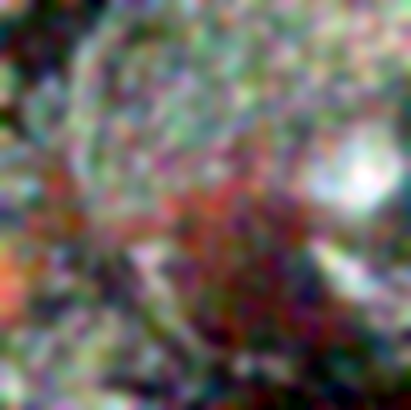
    <figcaption>t = 0.25</figcaption>
  </figure>
  <figure>
    
    <figcaption>t = 0.5</figcaption>
  </figure>
  <figure>
    
    <figcaption>t = 0.75</figcaption>
  </figure>

### One-Step Denoising
Assuming we have a neural network trained to predict the velocity, and a noisy image $x_t$, how might we estimate a cleaned image $x_1$? We are $1-t$ "time units" away from the final image, so we should follow the predicted velocity for that duration, to reach a cleaned image. Mathematically, we compute

\[
\hat{x}_1 = x_t + (1 - t)v_\theta(x_t, t, c).
\]

Here are the results:

  <figure>
    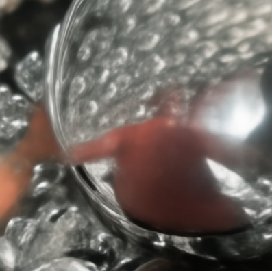
    <figcaption>t = 0.25</figcaption>
  </figure>
  <figure>
    
    <figcaption>t = 0.5</figcaption>
  </figure>
  <figure>
    
    <figcaption>t = 0.75</figcaption>
  </figure>

### Visualizing Velocity
Let's next see what is the difference between the true and predicted step, $(1-t)v$. In general we cannot expect the neural network to predict velocity perfectly, even for images it was trained on, but we hope that it was able to generalize well enough to get pretty close. In other words, we hope that it has *learned* what looks like noise, and how to remove it.

We'll measure error by the square root sum of squares accross color channels.

\[
E_t = \sqrt{\mathrm{mean}_{\mathrm{RGB}}\left(\left[(1-t)(\hat{v}_t - v_{\mathrm{gt}})\right]^2\right)}.
\]

  

  
noisy

  
predicted v

  
ground truth v

  
error

  
t = 0.25

  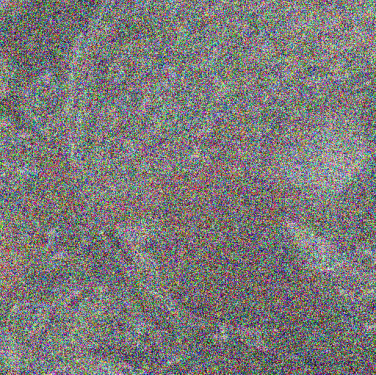
  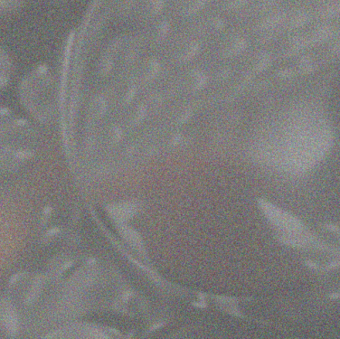
  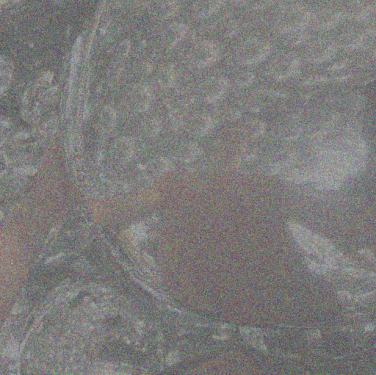
  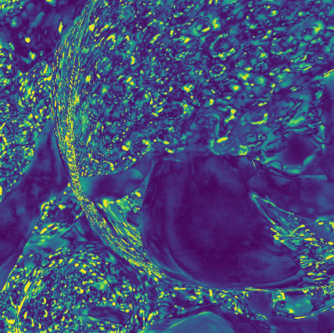

  
t = 0.50

  
  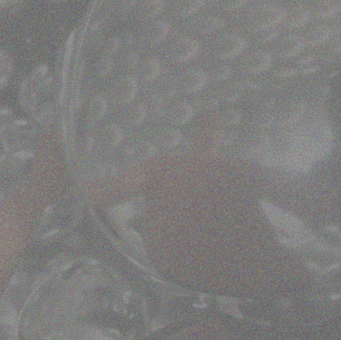
  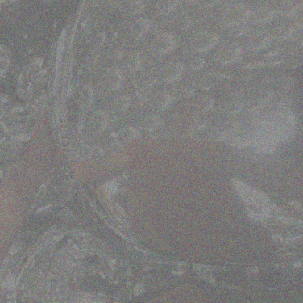
  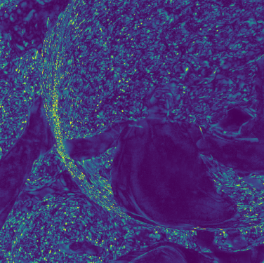

  
t = 0.75

  
  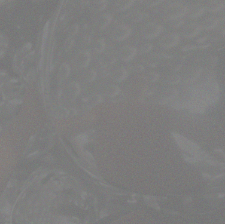
  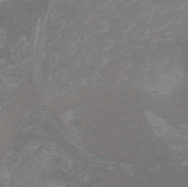
  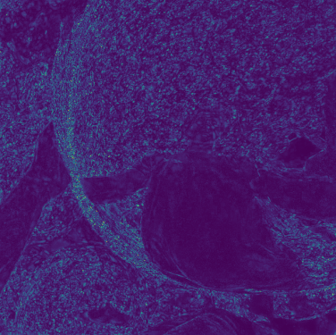

### Iterative Denoising with Euler Sampling
The results are even better if, instead of taking one big step of size $1-t$, we split that up into smaller steps. This way, we can use a different predicted velocity at each step, allowing the model to generate *curved* pathways through the ultra-high dimensional image space. Mathematically, each update step is

\[
x_{t+h} = x_t + h v_\theta(x_t, t, c).
\]

where we choose a small $h$ and repeat until we reach $x_1$. Even though none of the training images actually follow a curved path, this makes denoising a lot more flexible, by allowing the model to update its velocity prediction as it goes.

Let's visualize this by taking small steps $h=0.02$ and seeing the denoised-so-far image every five steps.

  <figure>
    
    <figcaption>t = 0.50</figcaption>
  </figure>
  <figure>
    
    <figcaption>t = 0.60</figcaption>
  </figure>
  <figure>
    
    <figcaption>t = 0.70</figcaption>
  </figure>
  <figure>
    
    <figcaption>t = 0.80</figcaption>
  </figure>
  <figure>
    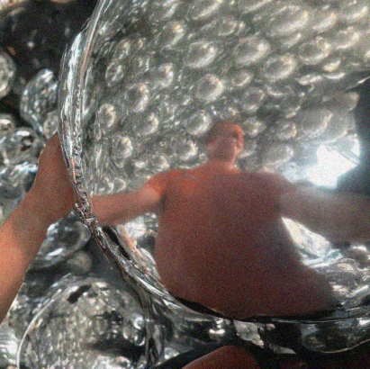
    <figcaption>t = 0.90</figcaption>
  </figure>
  <figure>
    
    <figcaption>t = 1.00</figcaption>
  </figure>

Here's a comparison of the denoising strategies applied to an image blurred with $t=0.5$, relative to the ground-truth original. Euler denoising clearly performs the best!

  <figure>
    
    <figcaption>original</figcaption>
  </figure>
  <figure>
    
    <figcaption>blur</figcaption>
  </figure>
  <figure>
    
    <figcaption>one step</figcaption>
  </figure>
  <figure>
    
    <figcaption>euler</figcaption>
  </figure>

### Generating Images from Noise
The *exact same process* works for generating *new* images! We simply denoise *pure noise*, giving the neural network complete "control" over where it goes in the vast space of images. Here are some results:

  <figure>
    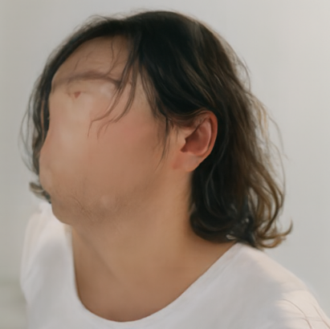
    <figcaption>seed 180</figcaption>
  </figure>
  <figure>
    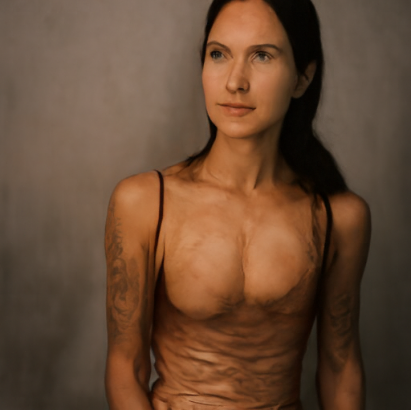
    <figcaption>seed 181</figcaption>
  </figure>
  <figure>
    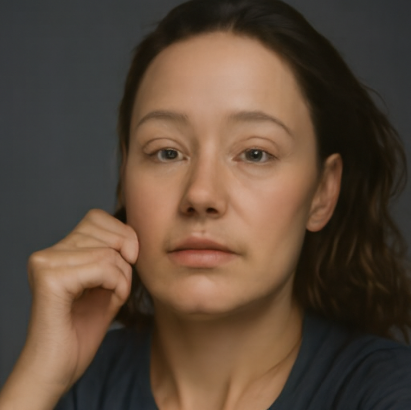
    <figcaption>seed 182</figcaption>
  </figure>
  <figure>
    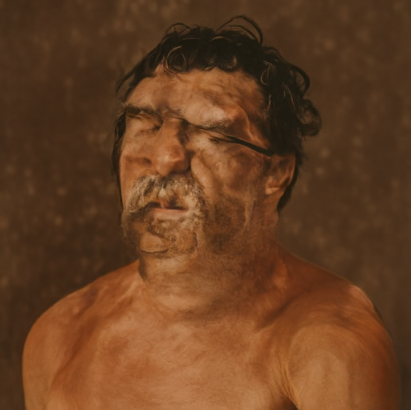
    <figcaption>seed 183</figcaption>
  </figure>
  <figure>
    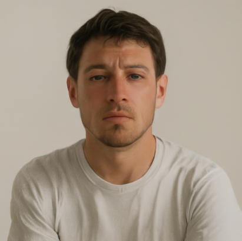
    <figcaption>seed 184</figcaption>
  </figure>
  <figure>
    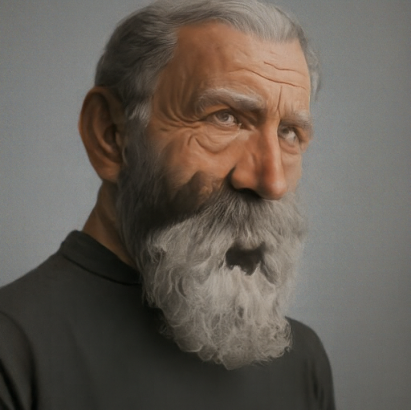
    <figcaption>seed 185</figcaption>
  </figure>
  <figure>
    
    <figcaption>seed 186</figcaption>
  </figure>
  <figure>
    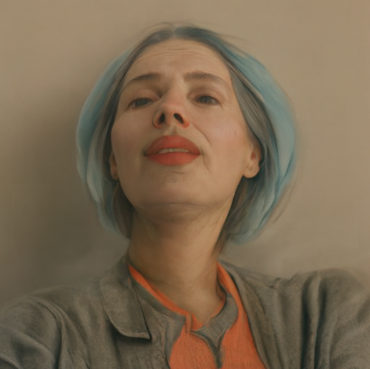
    <figcaption>seed 187</figcaption>
  </figure>

It's interesting that these are all pictures of (grossly deformed) people.

### Conditional Generation and Guidance
The images look better if we do something called *classifier-free guidance*. It turns out that the neural network is conditioned not only on $t$, but some given prompt $c$. For the images above, the prompt was "a high-quality photo."

Classifier-free guidance is a method of strengthening the effect of the given text prompt. I consider the prompt as something which gives some extra information, guiding the model to push the noise toward a particular *subset* of the vast real image domain (blue), which is already a subset of the even-vaster image domain (red).

Consider the prior visualization of the space of images. Below, I drew explicitly a subset of real images, say "high-quality photos," in orange. The model in theory knows where the high quality photo images are, but that signal is drowned out by the comparatively larger unconditioned velocity (purple arrow), which just wants to push the noise in the general direction of real images.

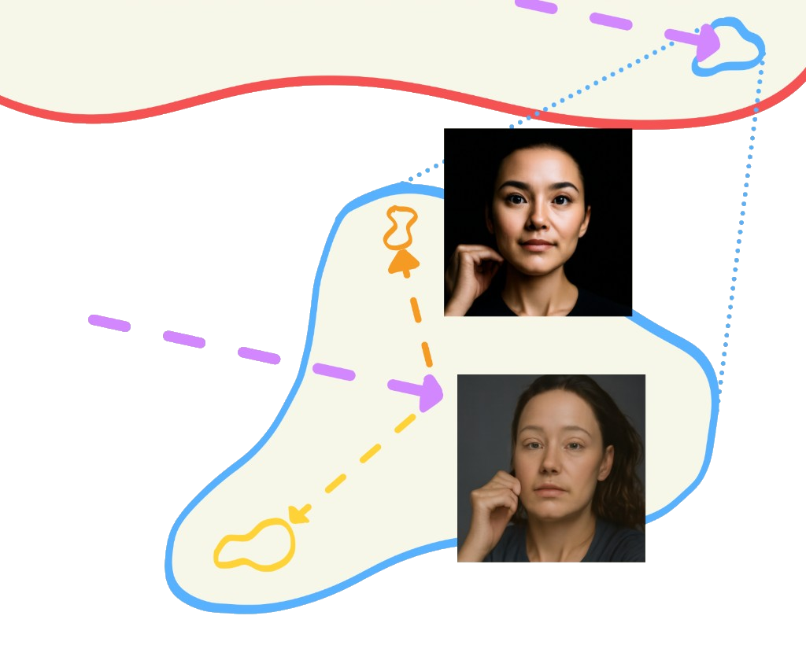

In other words, the problem is that the velocity to push noise in the general direction of real images is *much stronger* than any velocity in the specific direction of high-quality photos. If we boost up the difference-velocity (orange arrow), we might get a result closer to the true space of images under our prompt!

Mathematically, we define a new velocity

\[
v_{\mathrm{cfg}} = v_c + w(v_c - v_u).
\]

where $v_c$ is the prompt-conditioned velocity, and $v_u$ is the unconditioned velocity. The images below show the improvement with $w = 7$.

  <figure>
    
    <figcaption>seed 180 · w = 7</figcaption>
  </figure>
  <figure>
    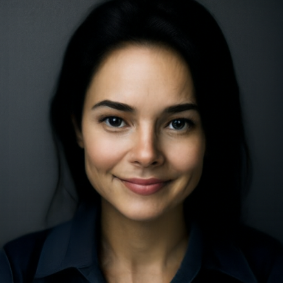
    <figcaption>seed 181 · w = 7</figcaption>
  </figure>
  <figure>
    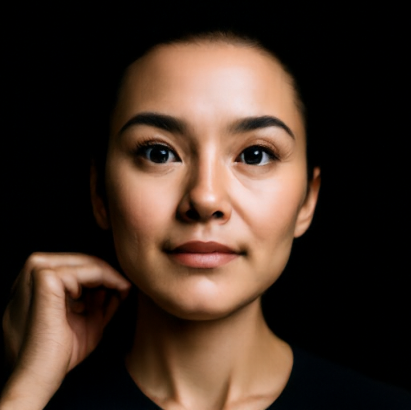
    <figcaption>seed 182 · w = 7</figcaption>
  </figure>
  <figure>
    
    <figcaption>seed 183 · w = 7</figcaption>
  </figure>
  <figure>
    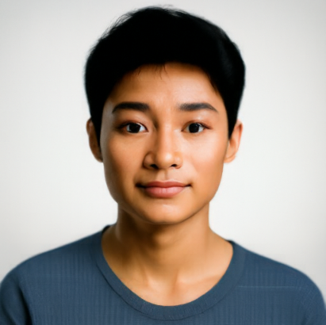
    <figcaption>seed 184 · w = 7</figcaption>
  </figure>
  <figure>
    
    <figcaption>seed 185 · w = 7</figcaption>
  </figure>
  <figure>
    
    <figcaption>seed 186 · w = 7</figcaption>
  </figure>
  <figure>
    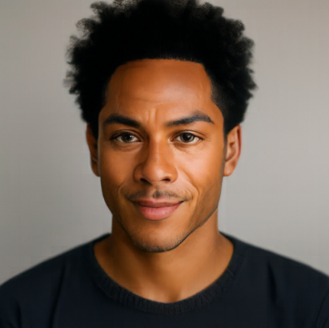
    <figcaption>seed 187 · w = 7</figcaption>
  </figure>

I find it interesting that some results look similar to the corresponding result without classifier-free-guidance, but others don't. For example, seed 182 clearly starts with some noise that "looks like" a hand, on the right side of the face, to the model. And the person (can I call this a person?) in seed 185 is sort-of looking in the same direction.

### Creative Applications
This section is all fun stuff: using a flow model to make cool images!

Suppose we noise up a real image and then let the model de-noise with the prompt "a high-quality photo." When enough noise is added such that there is not much real information left, the model has to make up some of that missing information. Hence, the result may look vaguely similar to the original, with some edits! Notice that with higher $t$ (less noise), the result is more like the original, because there is less flexibility for the model to be "creative."

First, I tested it on an image of Berkeley's Campanile.
##### Campanile

  <figure>
    
    <figcaption>original</figcaption>
  </figure>
  <figure>
    
    <figcaption>t = 0.02</figcaption>
  </figure>
  <figure>
    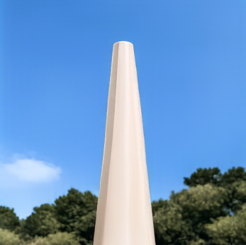
    <figcaption>t = 0.04</figcaption>
  </figure>
  <figure>
    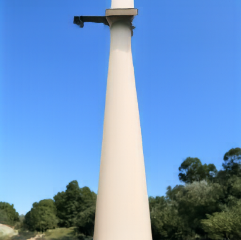
    <figcaption>t = 0.06</figcaption>
  </figure>
  <figure>
    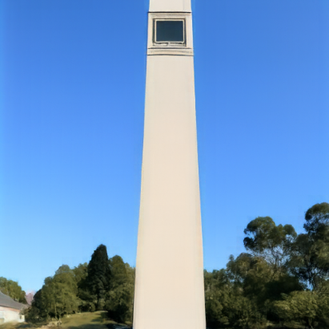
    <figcaption>t = 0.10</figcaption>
  </figure>
  <figure>
    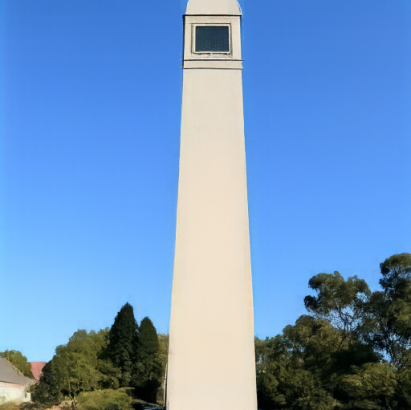
    <figcaption>t = 0.14</figcaption>
  </figure>
  <figure>
    
    <figcaption>t = 0.25</figcaption>
  </figure>
  <figure>
    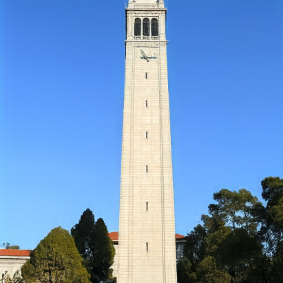
    <figcaption>t = 0.50</figcaption>
  </figure>

I also did this with images of some Star Wars characters. I don't imagine the model saw many science-fiction-movie pictures in its training, so it's cool to see how these get transformed by a projection into the space of real images sampled in the flow model's training.
##### Darth Vader

  <figure>
    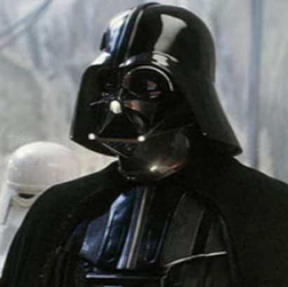
    <figcaption>original</figcaption>
  </figure>
  <figure>
    
    <figcaption>t = 0.02</figcaption>
  </figure>
  <figure>
    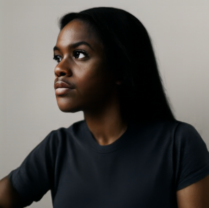
    <figcaption>t = 0.04</figcaption>
  </figure>
  <figure>
    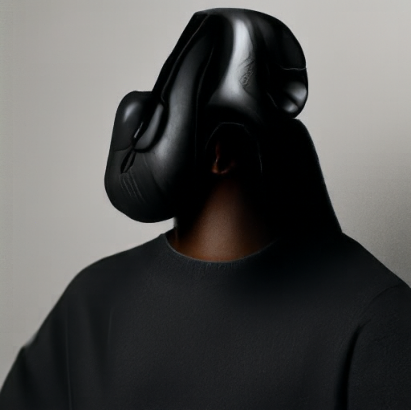
    <figcaption>t = 0.06</figcaption>
  </figure>
  <figure>
    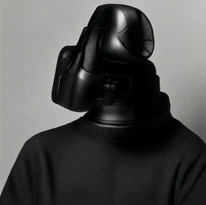
    <figcaption>t = 0.10</figcaption>
  </figure>
  <figure>
    
    <figcaption>t = 0.14</figcaption>
  </figure>
  <figure>
    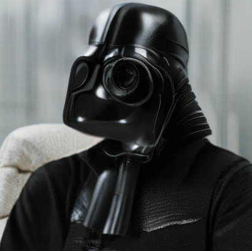
    <figcaption>t = 0.25</figcaption>
  </figure>
  <figure>
    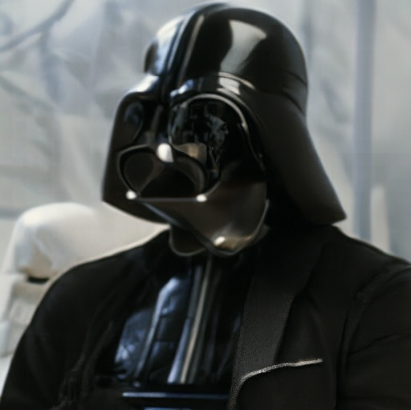
    <figcaption>t = 0.50</figcaption>
  </figure>

##### Chewbacca

  <figure>
    
    <figcaption>original</figcaption>
  </figure>
  <figure>
    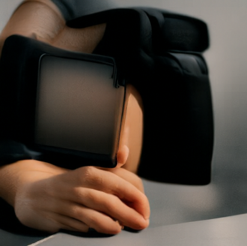
    <figcaption>t = 0.02</figcaption>
  </figure>
  <figure>
    
    <figcaption>t = 0.04</figcaption>
  </figure>
  <figure>
    
    <figcaption>t = 0.06</figcaption>
  </figure>
  <figure>
    
    <figcaption>t = 0.10</figcaption>
  </figure>
  <figure>
    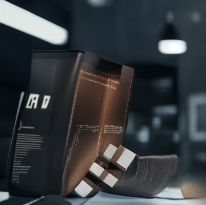
    <figcaption>t = 0.14</figcaption>
  </figure>
  <figure>
    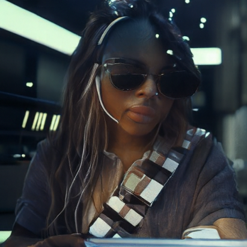
    <figcaption>t = 0.25</figcaption>
  </figure>
  <figure>
    
    <figcaption>t = 0.50</figcaption>
  </figure>

##### Ewok

  <figure>
    
    <figcaption>original</figcaption>
  </figure>
  <figure>
    
    <figcaption>t = 0.02</figcaption>
  </figure>
  <figure>
    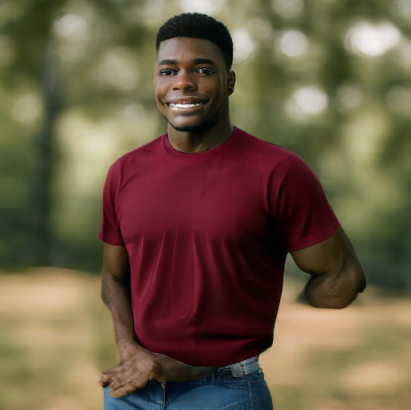
    <figcaption>t = 0.04</figcaption>
  </figure>
  <figure>
    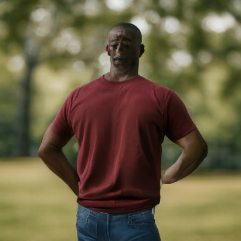
    <figcaption>t = 0.06</figcaption>
  </figure>
  <figure>
    
    <figcaption>t = 0.10</figcaption>
  </figure>
  <figure>
    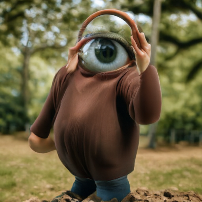
    <figcaption>t = 0.14</figcaption>
  </figure>
  <figure>
    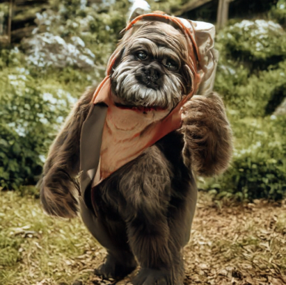
    <figcaption>t = 0.25</figcaption>
  </figure>
  <figure>
    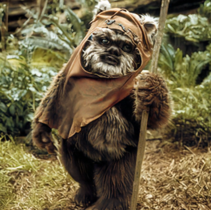
    <figcaption>t = 0.50</figcaption>
  </figure>

Then I did it with some drawings / illustrations. These are even further from the space of "high-quality photos" so they experience more severe warpage.
##### Bugs and Daffy

  <figure>
    
    <figcaption>original</figcaption>
  </figure>
  <figure>
    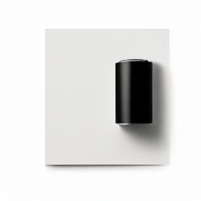
    <figcaption>t = 0.02</figcaption>
  </figure>
  <figure>
    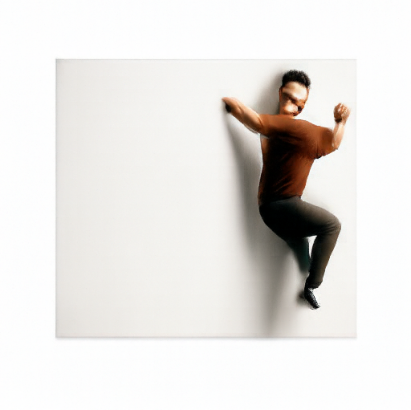
    <figcaption>t = 0.04</figcaption>
  </figure>
  <figure>
    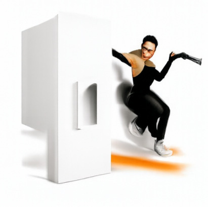
    <figcaption>t = 0.06</figcaption>
  </figure>
  <figure>
    
    <figcaption>t = 0.10</figcaption>
  </figure>
  <figure>
    
    <figcaption>t = 0.14</figcaption>
  </figure>
  <figure>
    
    <figcaption>t = 0.25</figcaption>
  </figure>
  <figure>
    
    <figcaption>t = 0.50</figcaption>
  </figure>

##### VW bus

  <figure>
    
    <figcaption>original</figcaption>
  </figure>
  <figure>
    
    <figcaption>t = 0.02</figcaption>
  </figure>
  <figure>
    
    <figcaption>t = 0.04</figcaption>
  </figure>
  <figure>
    
    <figcaption>t = 0.06</figcaption>
  </figure>
  <figure>
    
    <figcaption>t = 0.10</figcaption>
  </figure>
  <figure>
    
    <figcaption>t = 0.14</figcaption>
  </figure>
  <figure>
    
    <figcaption>t = 0.25</figcaption>
  </figure>
  <figure>
    
    <figcaption>t = 0.50</figcaption>
  </figure>

##### Eel

  <figure>
    
    <figcaption>original</figcaption>
  </figure>
  <figure>
    
    <figcaption>t = 0.02</figcaption>
  </figure>
  <figure>
    
    <figcaption>t = 0.04</figcaption>
  </figure>
  <figure>
    
    <figcaption>t = 0.06</figcaption>
  </figure>
  <figure>
    
    <figcaption>t = 0.10</figcaption>
  </figure>
  <figure>
    
    <figcaption>t = 0.14</figcaption>
  </figure>
  <figure>
    
    <figcaption>t = 0.25</figcaption>
  </figure>
  <figure>
    
    <figcaption>t = 0.50</figcaption>
  </figure>

The illustrations I made are good, but not *that* good. So, I wanted to try image-editing on some nicer art from my grandfather, who was an amazing artist. He made a living drawing advertisements for the yellow pages long ago. People can't really do *that* nowadays, can they? Is it poetic or heretic for me to use the very technology that made his profession obselete to edit his art? Anyway...

I took the nicest pictures I could of some of my favorite paintings of his and fed these into the flow model. If you zoom in on some of them, you'll see his signature, namely the signature of the great David Black.
##### Rose

  <figure>
    
    <figcaption>original</figcaption>
  </figure>
  <figure>
    
    <figcaption>t = 0.02</figcaption>
  </figure>
  <figure>
    
    <figcaption>t = 0.04</figcaption>
  </figure>
  <figure>
    
    <figcaption>t = 0.06</figcaption>
  </figure>
  <figure>
    
    <figcaption>t = 0.10</figcaption>
  </figure>
  <figure>
    
    <figcaption>t = 0.14</figcaption>
  </figure>
  <figure>
    
    <figcaption>t = 0.25</figcaption>
  </figure>
  <figure>
    
    <figcaption>t = 0.50</figcaption>
  </figure>

##### Sailboat 1

  <figure>
    
    <figcaption>original</figcaption>
  </figure>
  <figure>
    
    <figcaption>t = 0.02</figcaption>
  </figure>
  <figure>
    
    <figcaption>t = 0.04</figcaption>
  </figure>
  <figure>
    
    <figcaption>t = 0.06</figcaption>
  </figure>
  <figure>
    
    <figcaption>t = 0.10</figcaption>
  </figure>
  <figure>
    
    <figcaption>t = 0.14</figcaption>
  </figure>
  <figure>
    
    <figcaption>t = 0.25</figcaption>
  </figure>
  <figure>
    
    <figcaption>t = 0.50</figcaption>
  </figure>

##### Sailboat 2

  <figure>
    
    <figcaption>original</figcaption>
  </figure>
  <figure>
    
    <figcaption>t = 0.02</figcaption>
  </figure>
  <figure>
    
    <figcaption>t = 0.04</figcaption>
  </figure>
  <figure>
    
    <figcaption>t = 0.06</figcaption>
  </figure>
  <figure>
    
    <figcaption>t = 0.10</figcaption>
  </figure>
  <figure>
    
    <figcaption>t = 0.14</figcaption>
  </figure>
  <figure>
    
    <figcaption>t = 0.25</figcaption>
  </figure>
  <figure>
    
    <figcaption>t = 0.50</figcaption>
  </figure>

##### Forest and Rowboat

  <figure>
    
    <figcaption>original</figcaption>
  </figure>
  <figure>
    
    <figcaption>t = 0.02</figcaption>
  </figure>
  <figure>
    
    <figcaption>t = 0.04</figcaption>
  </figure>
  <figure>
    
    <figcaption>t = 0.06</figcaption>
  </figure>
  <figure>
    
    <figcaption>t = 0.10</figcaption>
  </figure>
  <figure>
    
    <figcaption>t = 0.14</figcaption>
  </figure>
  <figure>
    
    <figcaption>t = 0.25</figcaption>
  </figure>
  <figure>
    
    <figcaption>t = 0.50</figcaption>
  </figure>

Just as we saw with the fully model-generated images, the results all look vaguely human at first. Then they turn into weird, smooth shapes, and we don't get something that looks much like the original until there is relatively little noise. We'd probably get better intermediate results if we used a better prompt.

### Text-Guided Image Editing
Next, I fed the same images as in the prior part to the flow model, with some prompts guiding the model to made some desired changes. For the illustrations, I literally described the image; in these cases, the drawing is edited to look more real while staying faithful to the original. For others, I took some creative liberty to see some interesting modifications to the original.
##### a photograph of a tall candle nested within an evergreen wreath

  <figure>
    
    <figcaption>original</figcaption>
  </figure>
  <figure>
    
    <figcaption>t = 0.02</figcaption>
  </figure>
  <figure>
    
    <figcaption>t = 0.04</figcaption>
  </figure>
  <figure>
    
    <figcaption>t = 0.06</figcaption>
  </figure>
  <figure>
    
    <figcaption>t = 0.10</figcaption>
  </figure>
  <figure>
    
    <figcaption>t = 0.14</figcaption>
  </figure>
  <figure>
    
    <figcaption>t = 0.25</figcaption>
  </figure>
  <figure>
    
    <figcaption>t = 0.50</figcaption>
  </figure>

##### lord dark helmet, a short-statured antagonist wearing an comically oversized black helmet
{:.fit-line}

  <figure>
    
    <figcaption>original</figcaption>
  </figure>
  <figure>
    
    <figcaption>t = 0.02</figcaption>
  </figure>
  <figure>
    
    <figcaption>t = 0.04</figcaption>
  </figure>
  <figure>
    
    <figcaption>t = 0.06</figcaption>
  </figure>
  <figure>
    
    <figcaption>t = 0.10</figcaption>
  </figure>
  <figure>
    
    <figcaption>t = 0.14</figcaption>
  </figure>
  <figure>
    
    <figcaption>t = 0.25</figcaption>
  </figure>
  <figure>
    
    <figcaption>t = 0.50</figcaption>
  </figure>

##### a candid photo of a DJ in a room full of audio equipment

  <figure>
    
    <figcaption>original</figcaption>
  </figure>
  <figure>
    
    <figcaption>t = 0.02</figcaption>
  </figure>
  <figure>
    
    <figcaption>t = 0.04</figcaption>
  </figure>
  <figure>
    
    <figcaption>t = 0.06</figcaption>
  </figure>
  <figure>
    
    <figcaption>t = 0.10</figcaption>
  </figure>
  <figure>
    
    <figcaption>t = 0.14</figcaption>
  </figure>
  <figure>
    
    <figcaption>t = 0.25</figcaption>
  </figure>
  <figure>
    
    <figcaption>t = 0.50</figcaption>
  </figure>

##### a picture of a photographer holding a camera and monopole

  <figure>
    
    <figcaption>original</figcaption>
  </figure>
  <figure>
    
    <figcaption>t = 0.02</figcaption>
  </figure>
  <figure>
    
    <figcaption>t = 0.04</figcaption>
  </figure>
  <figure>
    
    <figcaption>t = 0.06</figcaption>
  </figure>
  <figure>
    
    <figcaption>t = 0.10</figcaption>
  </figure>
  <figure>
    
    <figcaption>t = 0.14</figcaption>
  </figure>
  <figure>
    
    <figcaption>t = 0.25</figcaption>
  </figure>
  <figure>
    
    <figcaption>t = 0.50</figcaption>
  </figure>

##### an illustration of Bugs Bunny and Daffy Duck

  <figure>
    
    <figcaption>original</figcaption>
  </figure>
  <figure>
    
    <figcaption>t = 0.02</figcaption>
  </figure>
  <figure>
    
    <figcaption>t = 0.04</figcaption>
  </figure>
  <figure>
    
    <figcaption>t = 0.06</figcaption>
  </figure>
  <figure>
    
    <figcaption>t = 0.10</figcaption>
  </figure>
  <figure>
    
    <figcaption>t = 0.14</figcaption>
  </figure>
  <figure>
    
    <figcaption>t = 0.25</figcaption>
  </figure>
  <figure>
    
    <figcaption>t = 0.50</figcaption>
  </figure>

##### an illustration of a purple VW bus

  <figure>
    
    <figcaption>original</figcaption>
  </figure>
  <figure>
    
    <figcaption>t = 0.02</figcaption>
  </figure>
  <figure>
    
    <figcaption>t = 0.04</figcaption>
  </figure>
  <figure>
    
    <figcaption>t = 0.06</figcaption>
  </figure>
  <figure>
    
    <figcaption>t = 0.10</figcaption>
  </figure>
  <figure>
    
    <figcaption>t = 0.14</figcaption>
  </figure>
  <figure>
    
    <figcaption>t = 0.25</figcaption>
  </figure>
  <figure>
    
    <figcaption>t = 0.50</figcaption>
  </figure>

##### an illustration of an electric eel

  <figure>
    
    <figcaption>original</figcaption>
  </figure>
  <figure>
    
    <figcaption>t = 0.02</figcaption>
  </figure>
  <figure>
    
    <figcaption>t = 0.04</figcaption>
  </figure>
  <figure>
    
    <figcaption>t = 0.06</figcaption>
  </figure>
  <figure>
    
    <figcaption>t = 0.10</figcaption>
  </figure>
  <figure>
    
    <figcaption>t = 0.14</figcaption>
  </figure>
  <figure>
    
    <figcaption>t = 0.25</figcaption>
  </figure>
  <figure>
    
    <figcaption>t = 0.50</figcaption>
  </figure>

##### a photo of a white rose

  <figure>
    
    <figcaption>original</figcaption>
  </figure>
  <figure>
    
    <figcaption>t = 0.02</figcaption>
  </figure>
  <figure>
    
    <figcaption>t = 0.04</figcaption>
  </figure>
  <figure>
    
    <figcaption>t = 0.06</figcaption>
  </figure>
  <figure>
    
    <figcaption>t = 0.10</figcaption>
  </figure>
  <figure>
    
    <figcaption>t = 0.14</figcaption>
  </figure>
  <figure>
    
    <figcaption>t = 0.25</figcaption>
  </figure>
  <figure>
    
    <figcaption>t = 0.50</figcaption>
  </figure>

##### a picture of a sailboat on rough seas

  <figure>
    
    <figcaption>original</figcaption>
  </figure>
  <figure>
    
    <figcaption>t = 0.02</figcaption>
  </figure>
  <figure>
    
    <figcaption>t = 0.04</figcaption>
  </figure>
  <figure>
    
    <figcaption>t = 0.06</figcaption>
  </figure>
  <figure>
    
    <figcaption>t = 0.10</figcaption>
  </figure>
  <figure>
    
    <figcaption>t = 0.14</figcaption>
  </figure>
  <figure>
    
    <figcaption>t = 0.25</figcaption>
  </figure>
  <figure>
    
    <figcaption>t = 0.50</figcaption>
  </figure>

##### a photo of a sailboat exiting a cave at high speed

  <figure>
    
    <figcaption>original</figcaption>
  </figure>
  <figure>
    
    <figcaption>t = 0.02</figcaption>
  </figure>
  <figure>
    
    <figcaption>t = 0.04</figcaption>
  </figure>
  <figure>
    
    <figcaption>t = 0.06</figcaption>
  </figure>
  <figure>
    
    <figcaption>t = 0.10</figcaption>
  </figure>
  <figure>
    
    <figcaption>t = 0.14</figcaption>
  </figure>
  <figure>
    
    <figcaption>t = 0.25</figcaption>
  </figure>
  <figure>
    
    <figcaption>t = 0.50</figcaption>
  </figure>

##### a picture of a lonely rowboat on a winding river

  <figure>
    
    <figcaption>original</figcaption>
  </figure>
  <figure>
    
    <figcaption>t = 0.02</figcaption>
  </figure>
  <figure>
    
    <figcaption>t = 0.04</figcaption>
  </figure>
  <figure>
    
    <figcaption>t = 0.06</figcaption>
  </figure>
  <figure>
    
    <figcaption>t = 0.10</figcaption>
  </figure>
  <figure>
    
    <figcaption>t = 0.14</figcaption>
  </figure>
  <figure>
    
    <figcaption>t = 0.25</figcaption>
  </figure>
  <figure>
    
    <figcaption>t = 0.50</figcaption>
  </figure>

### Visual Anagrams
This is a simple technique to make an image that looks like something different from different angles. At each step, we can denoise $x_t$ normally with prompt $p_1$ to get a velocity $v_1$. We'll flip $x_t$ upside down and denoise with prompt $p_2$, then flip that velocity back to get $v_2$. Averaging the two takes a step in a direction that'll make the image look like $p_2$ when it's flipped upside-down.

\[
\begin{aligned}
v_1 &= v_{\mathrm{cfg}}(x_t, t, p_1) \\
v_2 &= \text{flip}(v_{\mathrm{cfg}}(\text{flip}(x_t), t, p_2)) \\
v &= (v_1 + v_2) / 2
\end{aligned}
\]

  

    

      

        flip
        

          <button type="button" data-flip="up" aria-pressed="true">upside-up</button>
          <button type="button" data-flip="down" aria-pressed="false">upside-down</button>
        

      

    

    <figure class="flip-result">
      
      <figcaption>a totem pole carved out of a tree</figcaption>
    </figure>
  

  

    

      

        flip
        

          <button type="button" data-flip="up" aria-pressed="true">upside-up</button>
          <button type="button" data-flip="down" aria-pressed="false">upside-down</button>
        

      

    

    <figure class="flip-result">
      
      <figcaption>a charcoal drawing of mushrooms and flowers growing out of stone</figcaption>
    </figure>
  

  

    

      

        flip
        

          <button type="button" data-flip="up" aria-pressed="true">upside-up</button>
          <button type="button" data-flip="down" aria-pressed="false">upside-down</button>
        

      

    

    <figure class="flip-result">
      
      <figcaption>detailed blueprints for a futuristic multi level farm</figcaption>
    </figure>
  

  

    

      

        flip
        

          <button type="button" data-flip="up" aria-pressed="true">upside-up</button>
          <button type="button" data-flip="down" aria-pressed="false">upside-down</button>
        

      

    

    <figure class="flip-result">
      
      <figcaption>a lithograph of three blind mice holding canes</figcaption>
    </figure>
  

### Hybrid Images
We can make hybrid images with a similar trick. Human vision is sensitive to low frequencies from far away and high frequencies from up close. Hence, we can combine the predicted velocities for two prompts by frequency. With a judicious choice of prompt, the resulting image looks like one thing from up close, but another from far away!

\[
\begin{aligned}
v_1 &= v_{\mathrm{cfg}}(x_t, t, p_1) \\
v_2 &= v_{\mathrm{cfg}}(x_t, t, p_2) \\
v &= f_{\text{lowpass}}(v_1) + f_{\text{highpass}}(v_2)
\end{aligned}
\]

  

    

      

        zoom
        

          <button type="button" data-hybrid-zoom="in" aria-pressed="true">in</button>
          <button type="button" data-hybrid-zoom="out" aria-pressed="false">out</button>
        

      

    

    <figure class="hybrid-result">
      
      <figcaption>an abandoned greenhouse filled with wilting roses</figcaption>
    </figure>
  

  

    

      

        zoom
        

          <button type="button" data-hybrid-zoom="in" aria-pressed="true">in</button>
          <button type="button" data-hybrid-zoom="out" aria-pressed="false">out</button>
        

      

    

    <figure class="hybrid-result">
      
      <figcaption>an ancient cave painting of a few hunters gathering around a fire</figcaption>
    </figure>
  

  

    

      

        zoom
        

          <button type="button" data-hybrid-zoom="in" aria-pressed="true">in</button>
          <button type="button" data-hybrid-zoom="out" aria-pressed="false">out</button>
        

      

    

    <figure class="hybrid-result">
      
      <figcaption>a gouache painting of a flock of birds flying through a cloud</figcaption>
    </figure>
  

  

    

      

        zoom
        

          <button type="button" data-hybrid-zoom="in" aria-pressed="true">in</button>
          <button type="button" data-hybrid-zoom="out" aria-pressed="false">out</button>
        

      

    

    <figure class="hybrid-result">
      
      <figcaption>a painting of a bustling riverfront marketplace</figcaption>
    </figure>
  

### Training a Single-Step Denoising UNet

In this part I train a U-Net to denoise handwritten digits. Recall, we "teach" a neural net how to remove noise by
+ giving it a noisy image
+ making it predict the clean image
+ comparing that prediction to the ground truth
+ adjusting the model parameters so as to make its predictions better

Through lots of training examples, the network becomes good enough to denoise images it has not yet seen. Let's visualize the training process.

#### Noising
We add to the original image $x$ some noise $\epsilon$, so the model sees $x + \sigma \epsilon$. Here are some noisy inputs for $\sigma = [0.0,0.2,0.4,0.5,0.6,0.8,1.0]$.
<figure>
  
</figure>

#### Training
Recall, the loss measures the difference between the model's prediction and the ground truth. We are trying to minimize this. Here's the plot of loss over time:
<figure>
  
</figure>
Here is the denoising results after just one epoch:
<figure>
  
</figure>
After five epochs, i.e. more training, the model should have gotten better at denoising! Here are those results:
<figure>
  
</figure>

#### Testing
Even though the model was trained on images noised with $\sigma=0.5$, we can test the model on images with more or less noise. Here is a denoised $3$:

  
σ

  
0.0

  
0.2

  
0.4

  
0.5

  
0.6

  
0.8

  
1.0

  
noisy

  
  
  
  
  
  
  
  
cleaned

  
  
  
  
  
  
  

And here is a $6$:

  
σ

  
0.0

  
0.2

  
0.4

  
0.5

  
0.6

  
0.8

  
1.0

  
noisy

  
  
  
  
  
  
  
  
cleaned

  
  
  
  
  
  
  

#### Denoising Pure Noise
Recall that we were able to denoise pure noise to create new images. If we try to do that naively, without any sort of conditioning, the result is always going to be the average of all the training inputs. Why is that? The model sees some random noise, which is completely independent of any particular digit, so its best bet is to predict a blurry blob that is close to *all* of the digits.

Here are the results; a plot of loss, and the predictions after one and five epochs:
<figure>
  
</figure>

<figure>
  
</figure>

<figure>
  
</figure>

#### Time-Conditioned Training
Instead of doing a one-step denoising with a constant noise level $\sigma$, we can train on samples of the form $x_t = (1-t) x_0 + t x_1$. This allows the model to learn how to *interpolate* between pure noise and a clean image. That is, the model sees a noisy image $x_t$ and a time $t$ and predicts the velocity that will push that noisy image towards $x_1$. Here is the loss plot after training:

<figure>
  
</figure>

#### Time-Conditioned Sampling
If we use euler sampling on this model, we can generate nicer samples. Specifically, by taking smaller steps to denoise the initial image, the model will be allowed to push $x_t$ toward something that looks like an actual digit; whereas if it had only a single step its best bet is to predict the average digit.

Visually, we can intuit the difference with this illustration:

With a single straight line (one prediction, in gray), the model has no reason to choose one of the digits on its own, so it predicts an average. If it takes lots of small steps (in black), those small steps may happen to take $x_t$ into an intermediate step that looks somewhat digit-ey (in this case, it landed near $9$). The model will predict *that* digit instead of a blurry average; and depending on the starting state, it may produce *different* digits.

These are the generated results after increasing time spent in training.

  
epoch 1

  

  
epoch 5

  

  
epoch 10

  

#### Adding Class-Conditioning
We can give the model more information if we condition also on which *digit* it is denoising, so that it can learn subtle differences in denoising different digits.
<figure>
  
  <figcaption>training loss</figcaption>
</figure>

This also gives *us* more control during the sampling stage. Now we can condition also on a desired digit so that the model spits out velocities that push the noise in the direction of a desired digit. If the model thinks it's denoising an eight, say, it will create velocities that make the noise look more like an eight! In the illustration I made, this corresponds to the red / purple trajectories.

  
epoch 1

  

  
epoch 5

  

  
epoch 10

  

We can also remove a learning rate scheduler; rather than starting training with a larger learning rate and decreasing it over time, we'll let it be constant. I made the learning rate a bit smaller to prevent large, unstable steps. I noticed that its loss plot tends to be lower than the learning rate scheduler's loss plot. I am not super knowledgeable of machine learning, so I am not entirely sure why this it the case, but perhaps it is because the large initial scheduled steps fluctuate more wildly.
<figure>
  
</figure>
Here are the generated images. I noticed that the results look better earlier, but after 10 epochs the model trained learning rate scheduler more consistently creates nicer samples.

  
epoch 1

  

  
epoch 5

  

  
epoch 10

  

