# Project 4

## Image Warping and Mosaicing

During the zeroth project in this class, I got to explore the way images are formed by a camera. It was helpful to imagine the field of view of a camera as a cone emanating outwards from the lens; equivalently, as some some light rays bouncing off objects and shooting through the camera's center of projection to land on the sensor. The picture is therefore a patch of the world - I like to think of the world, as a camera sees it, as objects pictures on spheres of different sizes centered on the center of projection - projected / flattened onto a plane. When you rotate the camera about its center of projection, you are just pointing the cone at a *different patch* of the *same spheres*. In this project I take a bunch of these picture-patches and stitch them together to create a mosaic. This is something like the panorama-mode of a cell phone camera. 

For this to work, you *must* take pictures from the *same* location, so that those pictures capture the *same* rays of light. Imagine a pinhole camera, where the camera sensor (image plane) collects all of the rays of light shooting through a tiny pinhole. If you rotate the camera, such that the pinhole is in the same spot, the rays captured in both images are the same. Note that if you *translate* the camera, this won't be true! 

Consider this drawing:

<figure>
  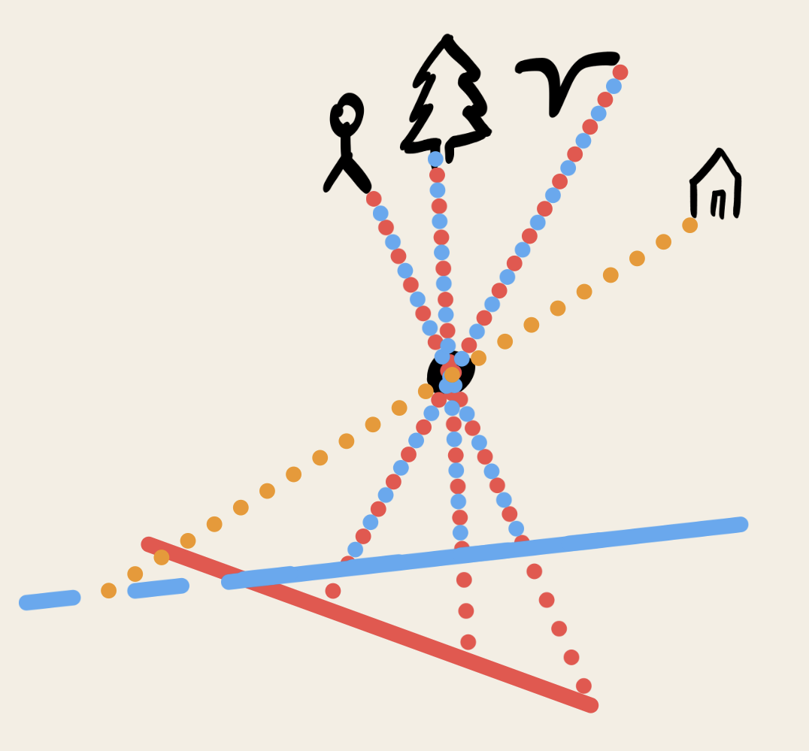
</figure>

The black dot is the 'pinhole' or 'center of projection' through which all the light rays pass, to land on the camera sensors (solid blue/red lines). Clearly, the *exact same* light rays (dotted red/blue lines) land on the sensors.

Assuming that the center of projection is the same in two images, you can use the fact that the rays coming from objects pictured in both images are identical, to compute something called a "homography." This transforms pixels in image red so that they "live" in the same coordinate system as image blue. In other words, you can _re-project_ the rays you captured in red onto the same image plane as that which blue was formed on.

For example, you could reproject the orange light ray captured by the red image onto the blue image to *extend the field of view of the blue image!*

To reiterate: it's OK to rotate the camera, but you _cannot_ translate it, to ensure that the rays of light appearing in both images are the same. Here are some sets of pictures I took, doing my best to hold my phone still while rotating around the camera's location.

##### Playground and Courts

  <figure>
    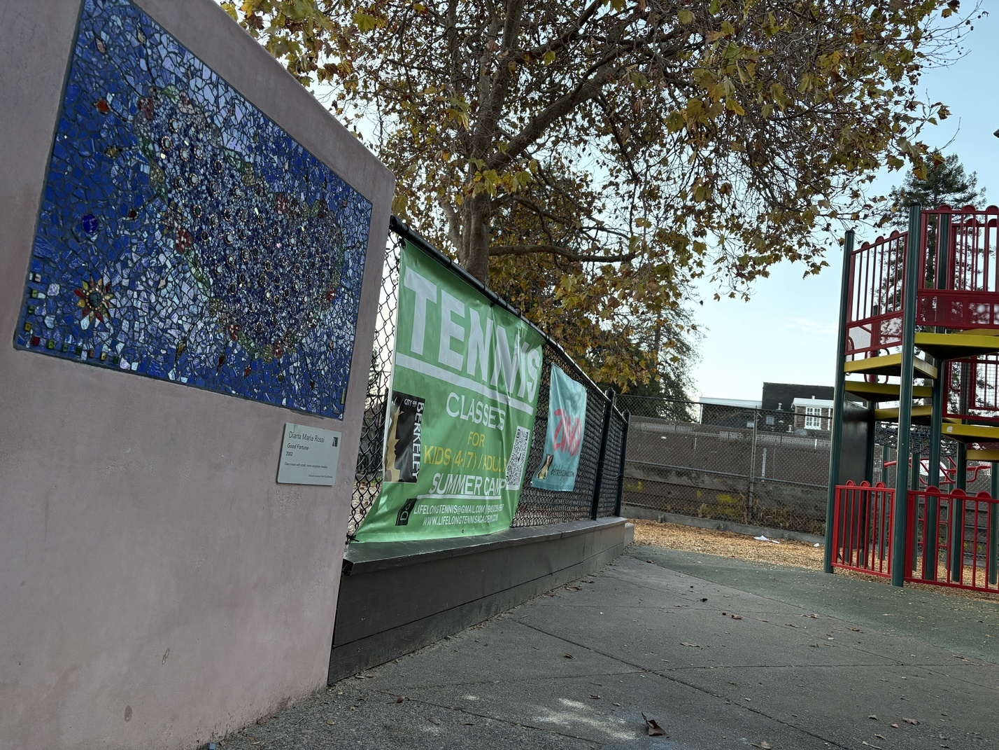
    <figcaption>left</figcaption>
  </figure>
  <figure>
    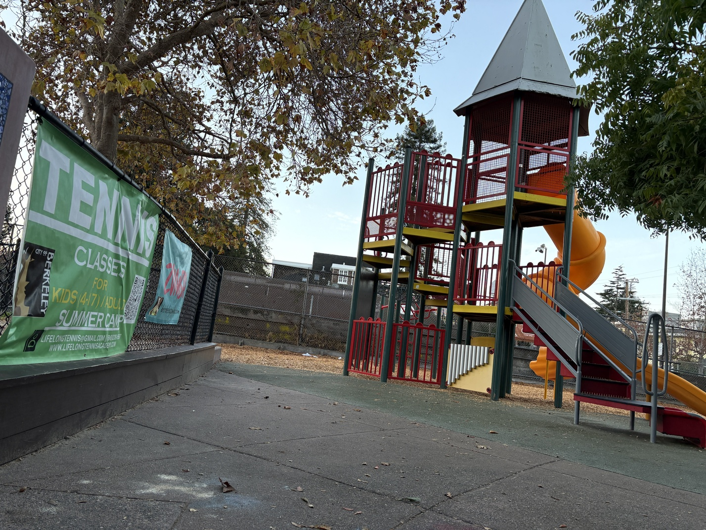
    <figcaption>middle</figcaption>
  </figure>
  <figure>
    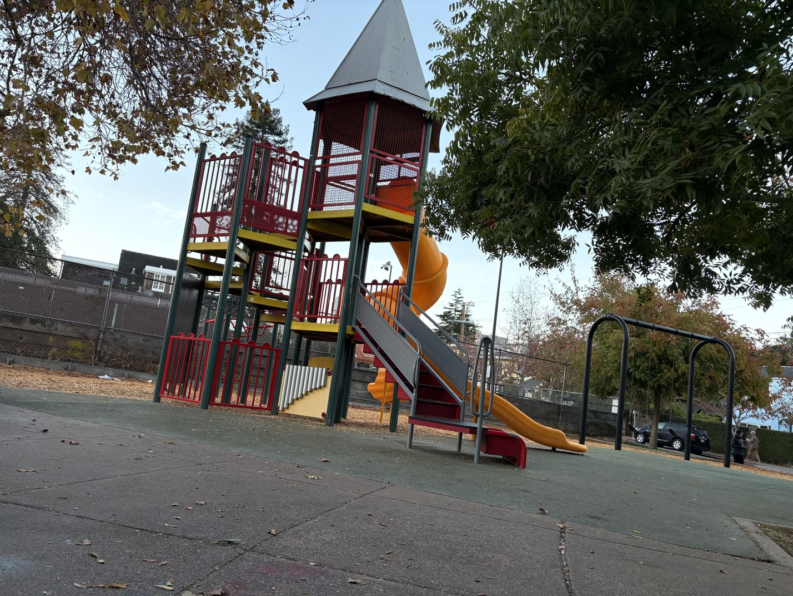
    <figcaption>right</figcaption>
  </figure>

##### Playground and a Sandbox

  <figure>
    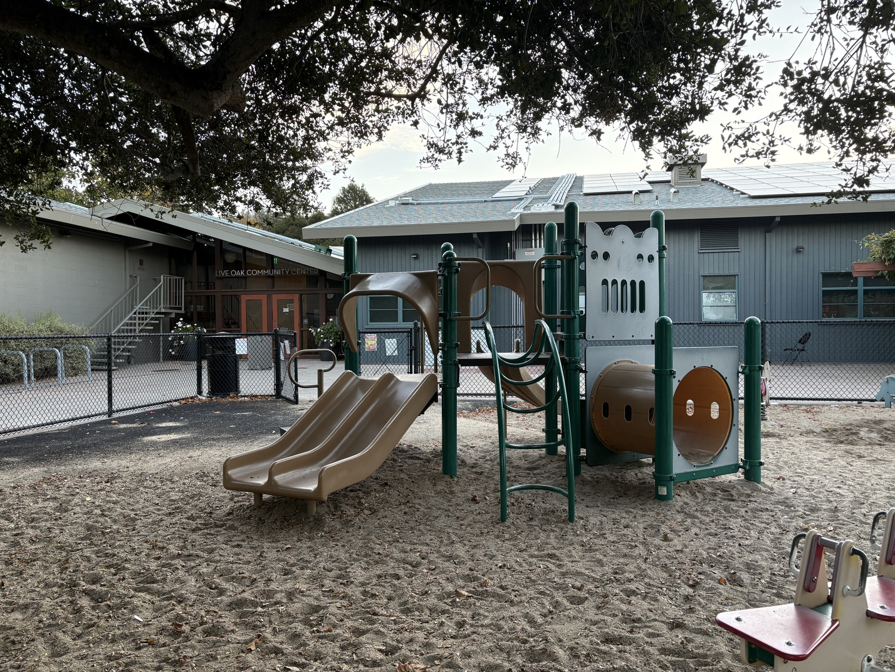
    <figcaption>left</figcaption>
  </figure>
  <figure>
    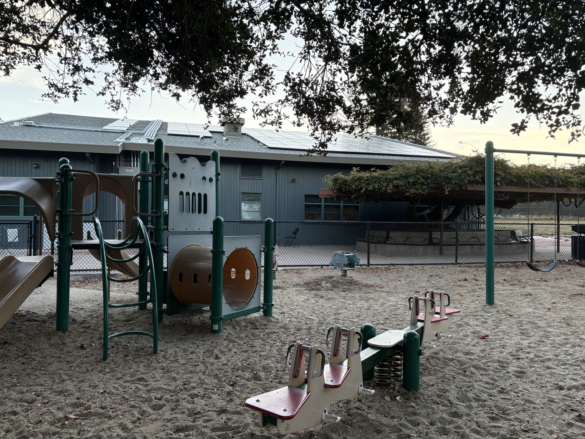
    <figcaption>middle</figcaption>
  </figure>
  <figure>
    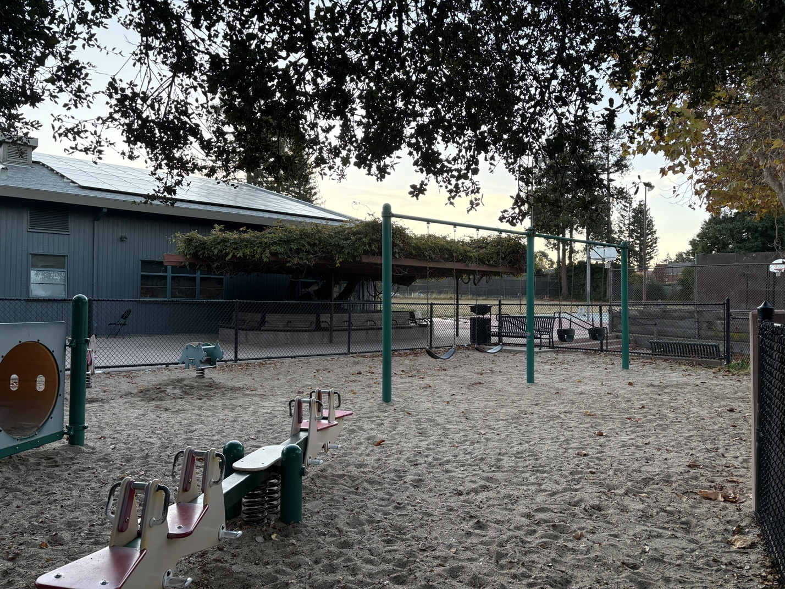
    <figcaption>right</figcaption>
  </figure>

##### Pantry

  <figure>
    
    <figcaption>left</figcaption>
  </figure>
  <figure>
    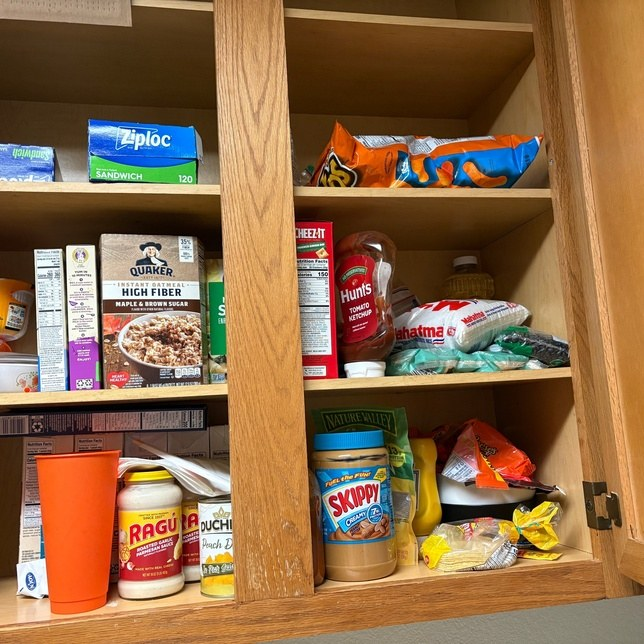
    <figcaption>right</figcaption>
  </figure>

##### Closet

  <figure>
    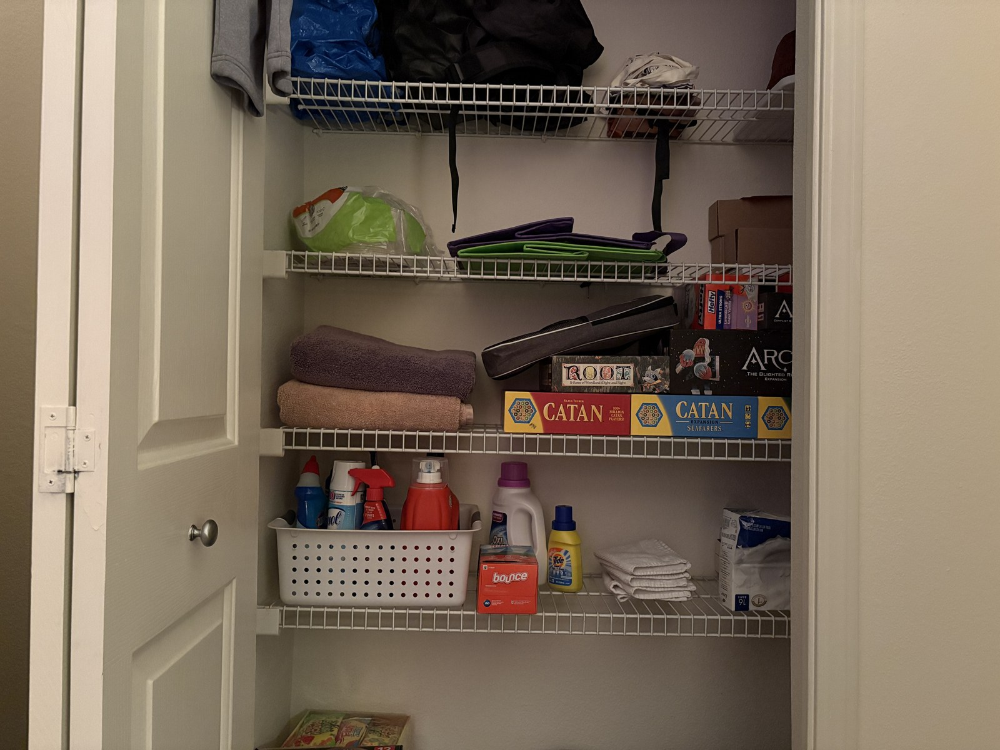
    <figcaption>top</figcaption>
  </figure>
  <figure>
    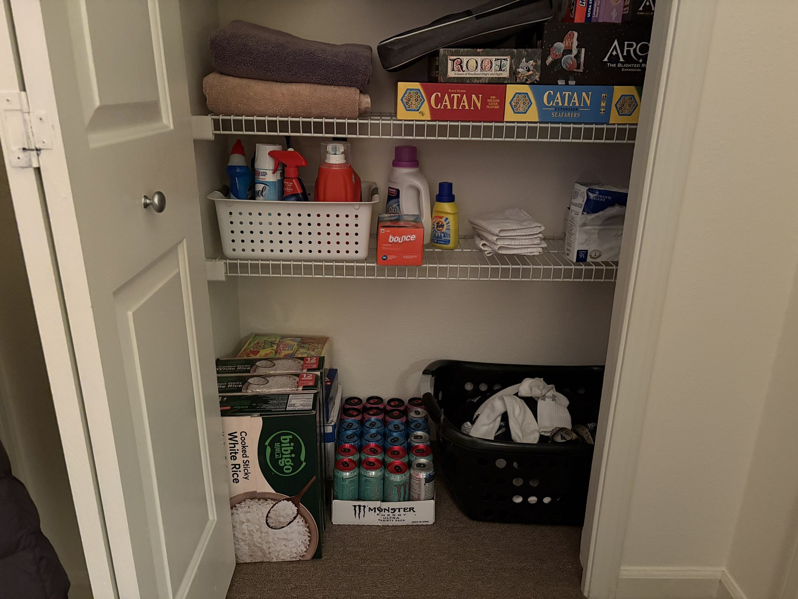
    <figcaption>bottom</figcaption>
  </figure>

##### Deer

  <figure>
    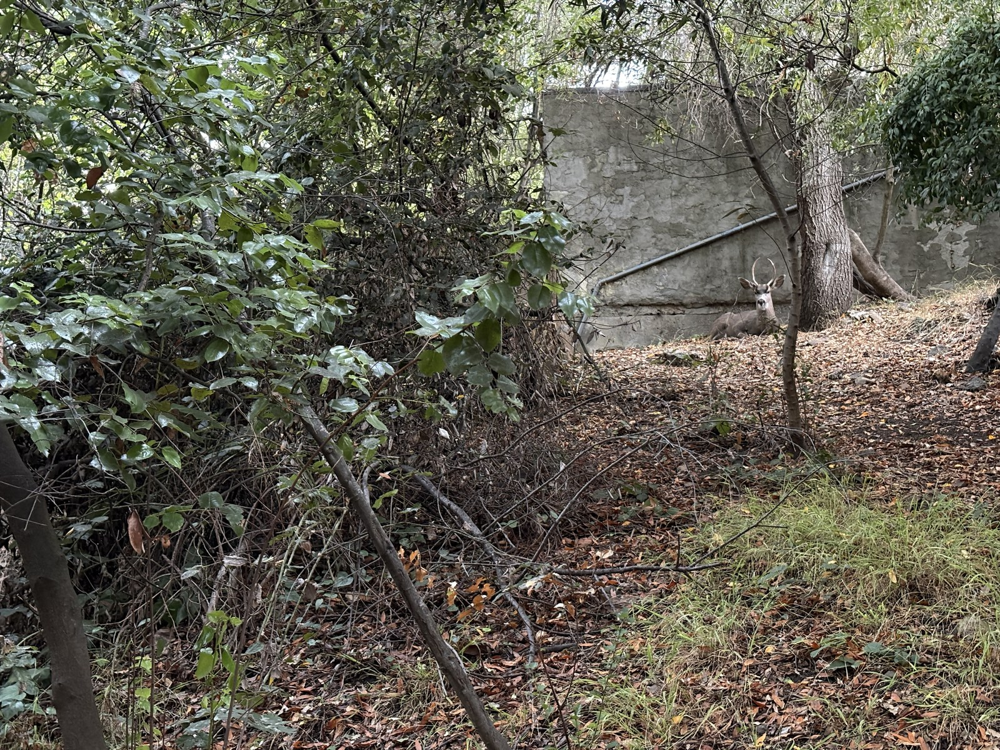
    <figcaption>left</figcaption>
  </figure>
  <figure>
    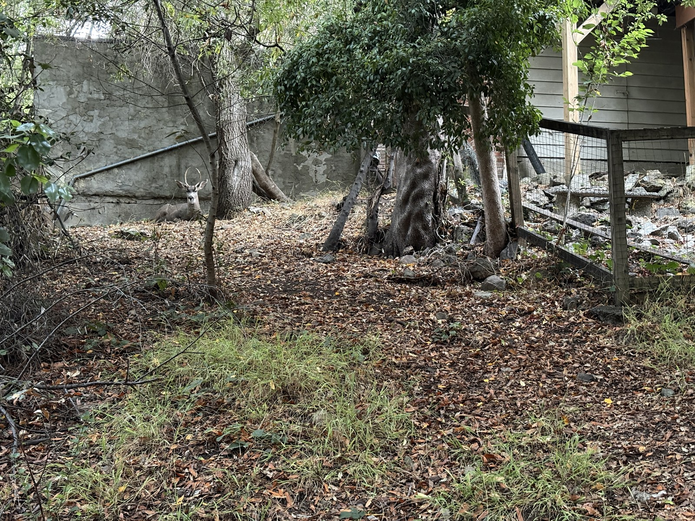
    <figcaption>right</figcaption>
  </figure>

### Recovering Homographies

A homography is a $3 \times 3$ matrix $H$ which maps a point $(x, y)$ in one image to a point $(x', y')$ in another. Why a $3 \times 3$ matrix to describe a transformation of $2\text{D}$ points? 

Intuitively, a $2 \times 2$ matrix always sends $(0, 0)$ to $(0, 0)$, so it can rotate, scale, and shear, but it cannot *shift*. By using *homogeneous coordinates*, i.e. tacking a $1$ onto the end of each point to encode a point as a $3\text{D}$ vector, we can encode translation with $H$. The equation relating $(x, y)$ to $(x', y')$ is

$$
\begin{bmatrix} wx' \\ wy' \\ w \end{bmatrix}
=
\begin{bmatrix}
h_1 & h_2 & h_3 \\
h_4 & h_5 & h_6 \\
h_7 & h_8 & 1
\end{bmatrix}
\begin{bmatrix} x \\ y \\ 1 \end{bmatrix}.
$$

In homogeneous coordinates, the $3^{\text{rd}}$ coordinates scales the first two, so $(wx', wy', w)$ is the same as $(x', y')$ for *any* $w$. This is intimately related to the way that a cameras capture light rays from objects; as $w$ varies, $(wx, wy, w)$ traces a line through the origin, i.e. a *ray* through the center of projection, and so dividing by $w$ determines where that ray intersects an image plane at $w=1$. 

Since multiplying all of $H$ by a constant only changes $w$, which we divide out at the end anyway, there are only $8$ unknowns. I think of these as follows. The top two rows alone describes an *affine* transformation (shifting, rotating, scaling). The bottom row is makes $w$ *depend on where you are in the image*, i.e. *projective*, since dividing by $w$ squishes or stretches $(x', y'$) according to $(x, y)$. This accomplishes precisely the "far-away-things look smaller" effect.

Dividing out $w = h_7 x + h_8 y + 1$, we have

$$
x' = \frac{h_1 x + h_2 y + h_3}{h_7 x + h_8 y + 1}, \qquad
y' = \frac{h_4 x + h_5 y + h_6}{h_7 x + h_8 y + 1}.
$$

This isn't yet linear in the unknowns $h_i$, but if we multiply through by the denominator and shuffle things around, we get:

$$
\begin{aligned}
h_1 x + h_2 y + h_3 - h_7 x x' - h_8 y x' &= x' \\
h_4 x + h_5 y + h_6 - h_7 x y' - h_8 y y' &= y'
\end{aligned}
$$

So each pair of corresponding points gives us *two* equations. Stacking up the equations for $n$ pairs of points gives a linear system $A\mathbf{h} = \mathbf{b}$:

$$
\begin{bmatrix}
x_1 & y_1 & 1 & 0 & 0 & 0 & -x_1 x_1' & -y_1 x_1' \\
0 & 0 & 0 & x_1 & y_1 & 1 & -x_1 y_1' & -y_1 y_1' \\
& & & & \vdots & & & \\
x_n & y_n & 1 & 0 & 0 & 0 & -x_n x_n' & -y_n x_n' \\
0 & 0 & 0 & x_n & y_n & 1 & -x_n y_n' & -y_n y_n'
\end{bmatrix}
\begin{bmatrix} h_1 \\ h_2 \\ \vdots \\ h_8 \end{bmatrix}
=
\begin{bmatrix} x_1' \\ y_1' \\ \vdots \\ x_n' \\ y_n' \end{bmatrix}
$$

With $n = 4$ points we have $8$ equations and $8$ unknowns, so we could solve exactly. Since in this part I am clicking corresponding points by hand, there is some error! By clicking more points, we construct an overdetermined system which can be solved robustly by least squares,

$$
\hat{\mathbf{h}} = \arg\min_{\mathbf{h}} \lVert A\mathbf{h} - \mathbf{b} \rVert_2^2,
$$

which in a sense averages out my clicking errors. I picked the points with `matplotlib`'s `ginput`. Here they are for the pantry scene:

  <figure>
    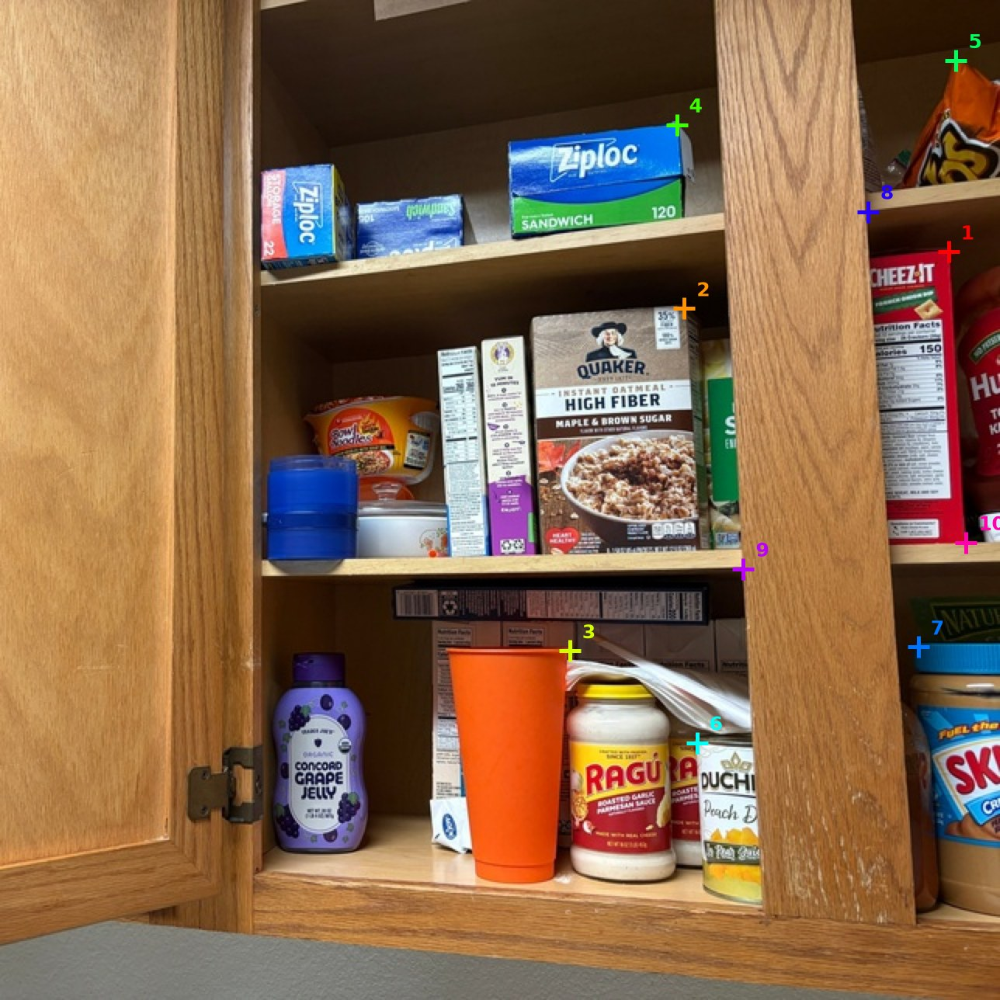
    <figcaption>left</figcaption>
  </figure>
  <figure>
    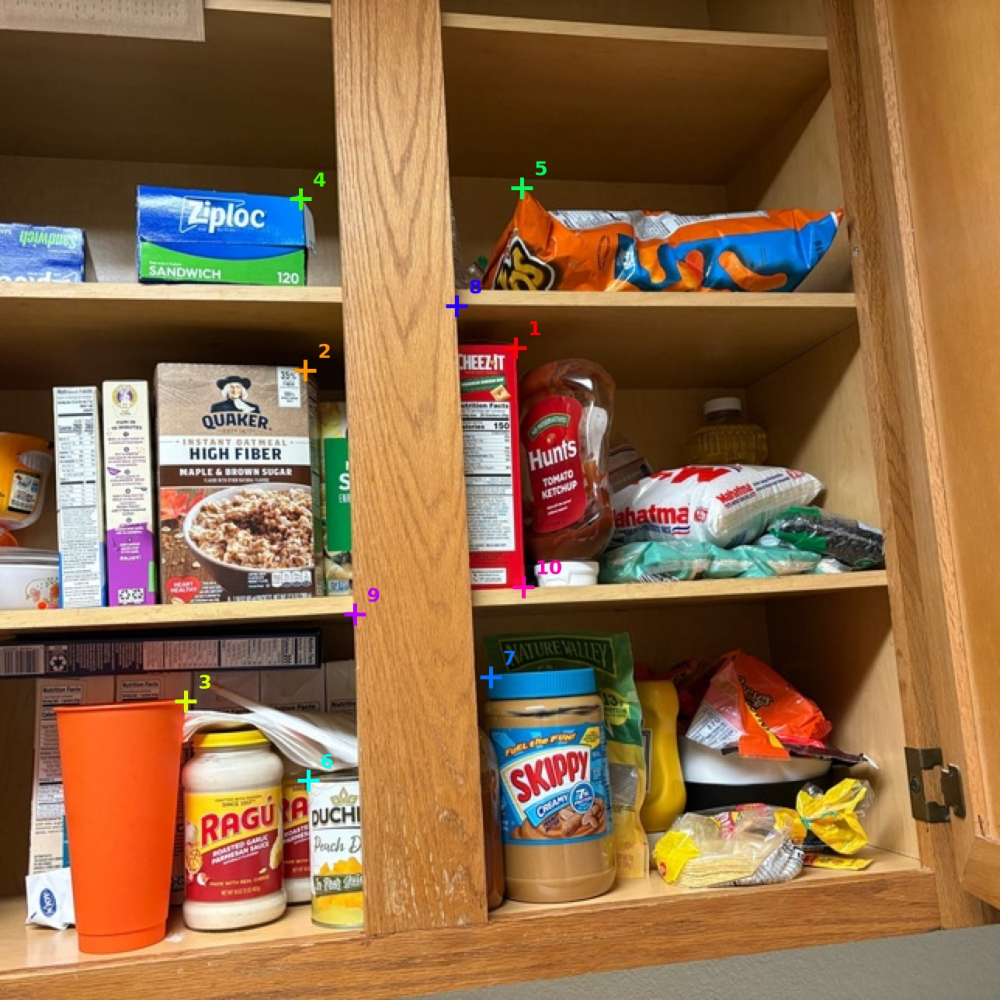
    <figcaption>right</figcaption>
  </figure>

There are $10$ pairs of points here, so $20$ equations for $8$ unknowns. Mapping the left image $(x, y)$ into the right image $(x', y')$, the system of equations for these points is

$$
\begin{bmatrix}
610.3 & 161.7 & 1 & 0 & 0 & 0 & -202356.9 & -53616.7 \\
0 & 0 & 0 & 610.3 & 161.7 & 1 & -136293.4 & -36112.4 \\
440.1 & 198.2 & 1 & 0 & 0 & 0 & -86360.1 & -38885.4 \\
0 & 0 & 0 & 440.1 & 198.2 & 1 & -104709.2 & -47147.4 \\
& & & & \vdots & & & \\
621.7 & 348.9 & 1 & 0 & 0 & 0 & -209141.6 & -117382.5 \\
0 & 0 & 0 & 621.7 & 348.9 & 1 & -234554.9 & -131645.9
\end{bmatrix}
\begin{bmatrix} h_1 \\ h_2 \\ \vdots \\ h_8 \end{bmatrix}
=
\begin{bmatrix} 331.5 \\ 223.3 \\ 196.2 \\ 237.9 \\ \vdots \\ 336.4 \\ 377.3 \end{bmatrix}
$$

and the recovered homography is

$$
H =
\begin{bmatrix}
1.556 & -0.037 & -387.1 \\
0.409 & 1.373 & -98.1 \\
1.13 \times 10^{-3} & -6.28 \times 10^{-5} & 1
\end{bmatrix}.
$$

Sending the left points through $H$ lands them (on average) within about $1$ pixel of where I clicked in the right image. For the other scenes I clicked $25$ pairs of points each ($15$ for the deer), and similarly set up a system of equations to be solved with least squares for a homography $H$.

##### Playground and Courts

  <figure>
    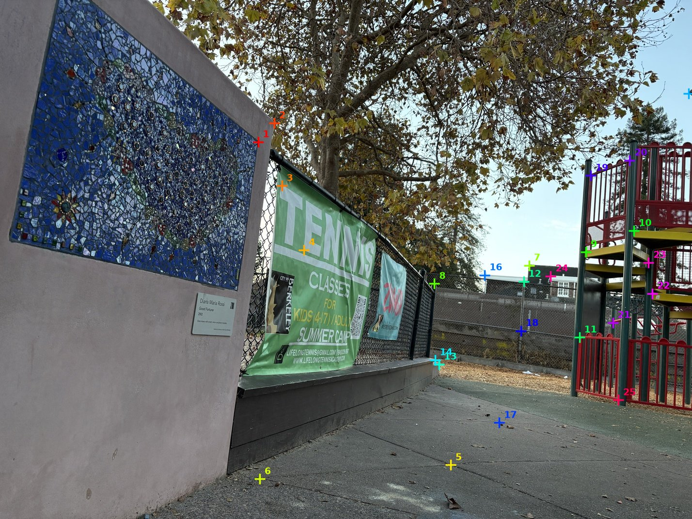
    <figcaption>left</figcaption>
  </figure>
  <figure>
    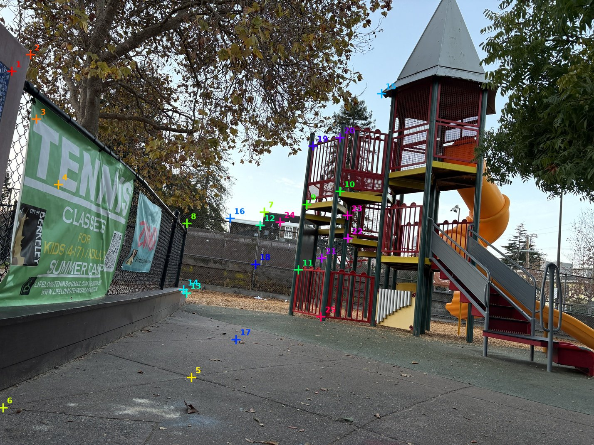
    <figcaption>middle</figcaption>
  </figure>

##### Playground and a Sandbox

  <figure>
    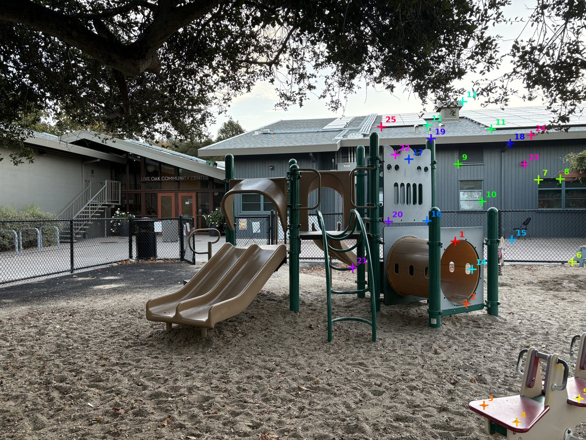
    <figcaption>left</figcaption>
  </figure>
  <figure>
    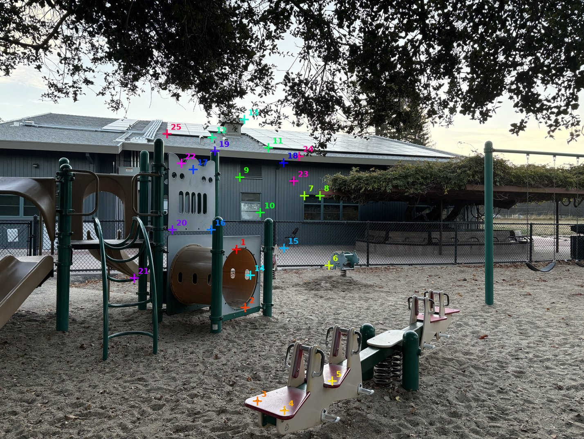
    <figcaption>middle</figcaption>
  </figure>

##### Closet

  <figure>
    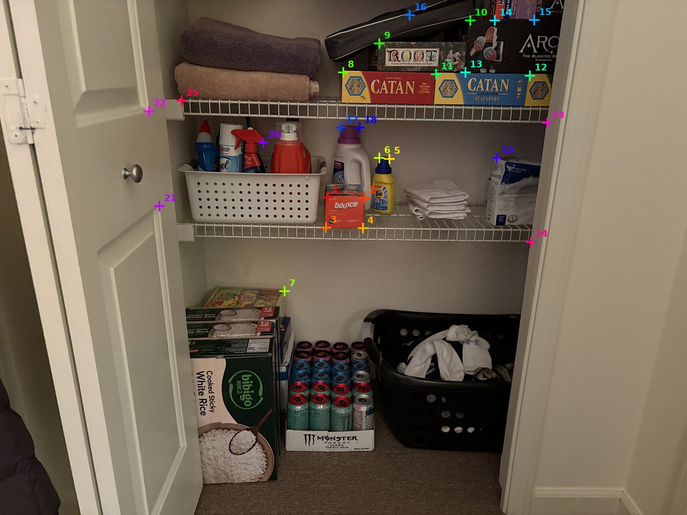
    <figcaption>bottom</figcaption>
  </figure>
  <figure>
    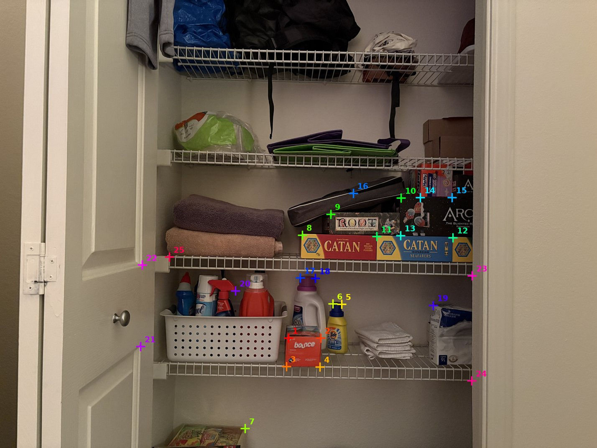
    <figcaption>top</figcaption>
  </figure>

##### Deer

  <figure>
    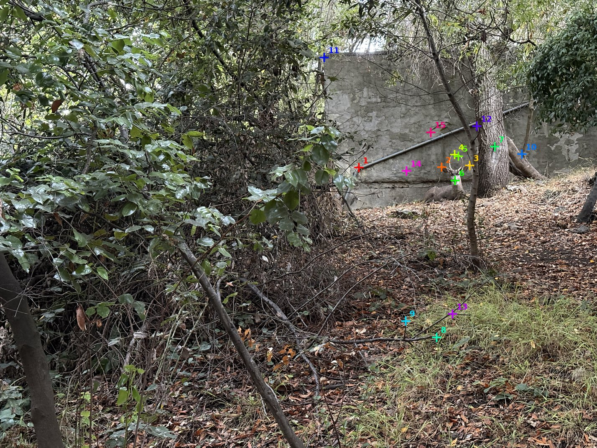
    <figcaption>left</figcaption>
  </figure>
  <figure>
    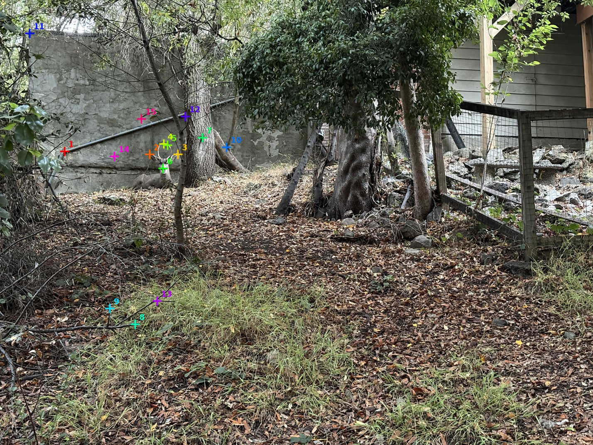
    <figcaption>right</figcaption>
  </figure>

### Warping the Images

We *could* use $H$ to *forward warp*: for each pixel in the source image, determine its position in the result with $H$ and fill it in. The problem is that $H$ stretches some parts of the image, so the source pixels might land on non-integer positions, which is a problem because pixels are indexed by integers.

Instead we will do *backwards warping*. That is, we will instead iterate through the result pixels, filling them in by applying $H^{-1}$. This is still not an integer, though! Suppose output index $(x', y') = (16, 47)$ maps from input "pixel" $(41.3, 17.8)$. How do we fill in the result? I tried two approaches.

**Nearest neighbor** interpolation just rounds; $(41.3, 17.8)$ becomes $(41, 18)$. This is fast and simple, but it could make edges look jagged.

**Bilinear** interpolation computes a weighted average of the four closest pixels, giving more weight to the ones that are closer. This is a bit more robust because it incorporates information from more surrounding pixels.

#### Rectification

To test our warping, we can use the pictures of things we *know* to be rectangular and warp them onto an arbitrary rectangular shape. The result ends up looking as if I took the picture head-on!

##### Book
<figure>
  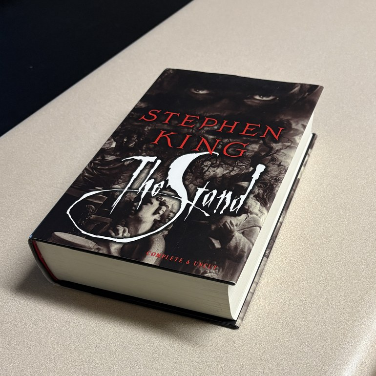
  <figcaption>original</figcaption>
</figure>

  <figure>
    
    <figcaption>nearest neighbor</figcaption>
  </figure>
  <figure>
    
    <figcaption>bilinear</figcaption>
  </figure>

##### Wallet
<figure>
  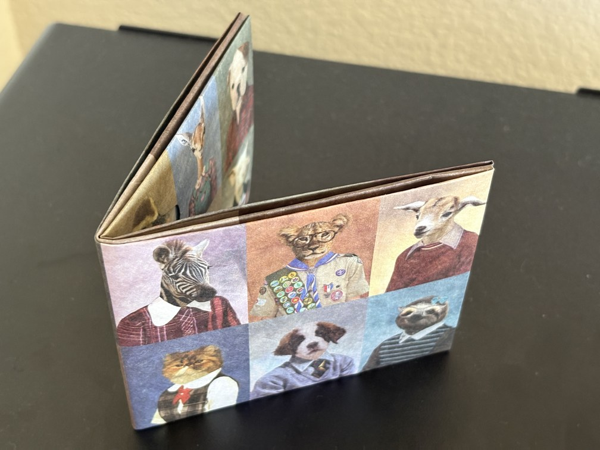
  <figcaption>original</figcaption>
</figure>

  <figure>
    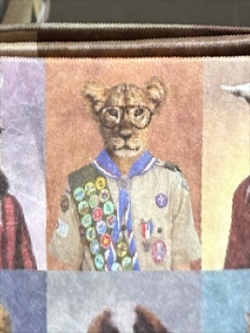
    <figcaption>nearest neighbor</figcaption>
  </figure>
  <figure>
    
    <figcaption>bilinear</figcaption>
  </figure>

##### Nixon
<figure>
  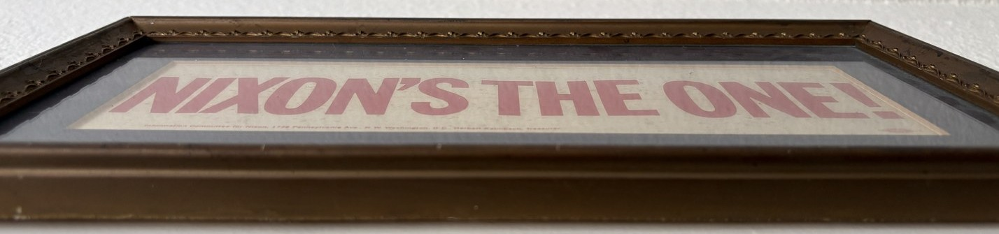
  <figcaption>original</figcaption>
</figure>

<figure>
  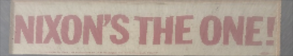
  <figcaption>nearest neighbor</figcaption>
</figure>

<figure>
  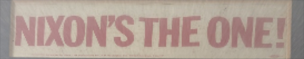
  <figcaption>bilinear</figcaption>
</figure>

Notice that the $3\text{D}$ structures get distorted, but the flat regions indeed look flat. For example, you can see some subtle waves in the nixon poster - it is not a perfectly flat rectangle! I didn't even notice this until I did the warp. 

The difference between the two interpolation methods is hard to see at this size, so here's a zoomed-in crop of the lettering on the book:

  <figure>
    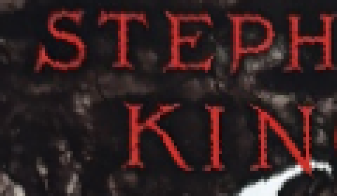
    <figcaption>nearest neighbor</figcaption>
  </figure>
  <figure>
    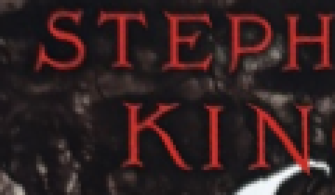
    <figcaption>bilinear</figcaption>
  </figure>

Edges in particular are distorted by the nearest neighbor strategy; a bilinear interpolation results in a smoother, nicer-looking result. The downside is that it is slightly more computationally expensive, since each pixel is a weighted average. I didn't find the slowdown too unbearable, so I will use bilinear interpolation for the remainder of the project.

### Blending the Images into a Mosaic

Now for the fun part. My procedure was:
1. Pick one image as the reference, and leave it unwarped.
2. Compute a homography from each of the other images into the reference image's plane.
4. Warp every image onto the reference plane's canvas.
5. Blend the images, using a mask computed by comparing each pixel's distance from an edge in either one.

The simplest way to do step 4 is to paste the images down one at a time. This looks bad. The seams are obvious, because the pictures never *quite* match in brightness, and because any small misalignment is obvious. Instead, I used a multi-level laplacian blend, like that I explored in the second project for this class. See the difference:

  <figure>
    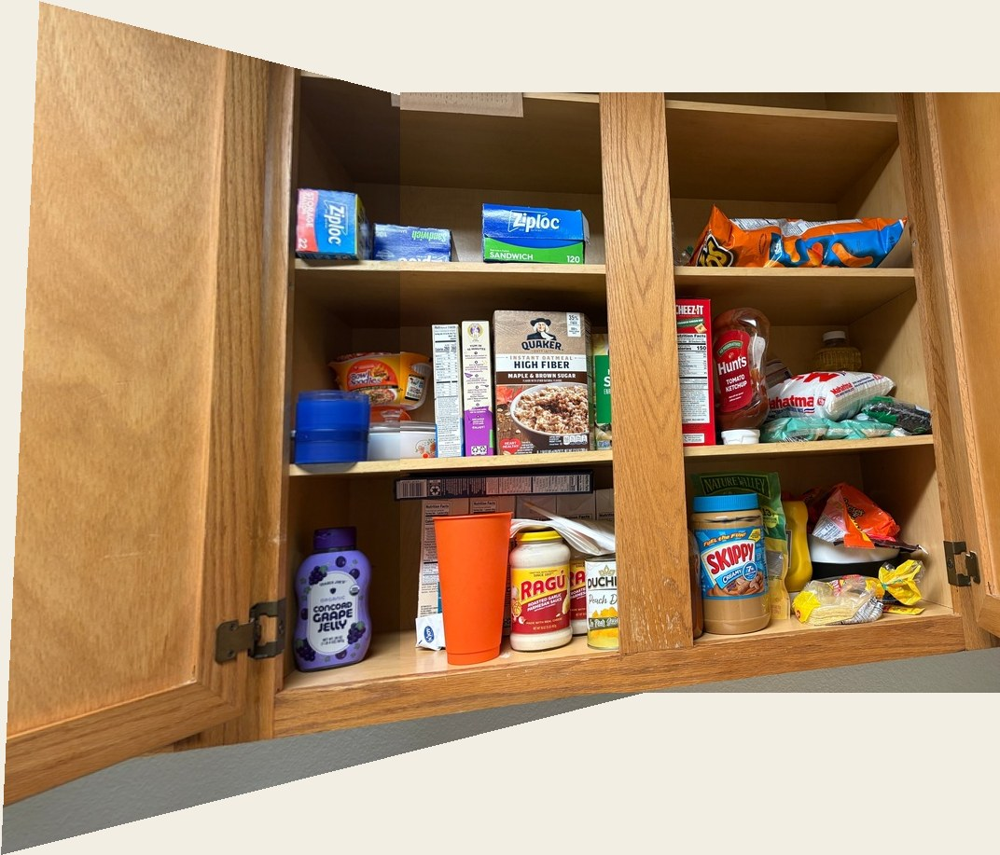
    <figcaption>simple overwrite</figcaption>
  </figure>
  <figure>
    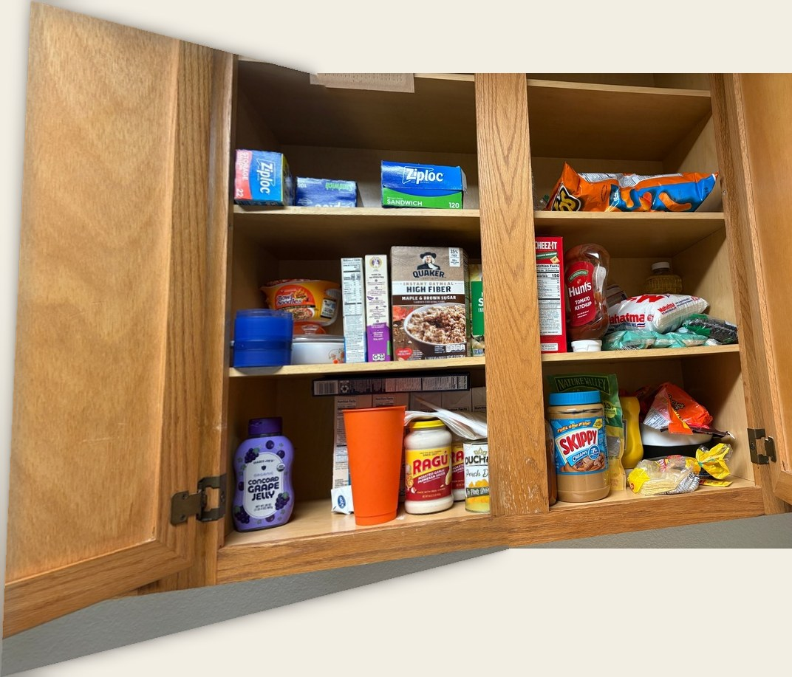
    <figcaption>blended</figcaption>
  </figure>

Here are the results:

##### Playground and Courts
<figure>
  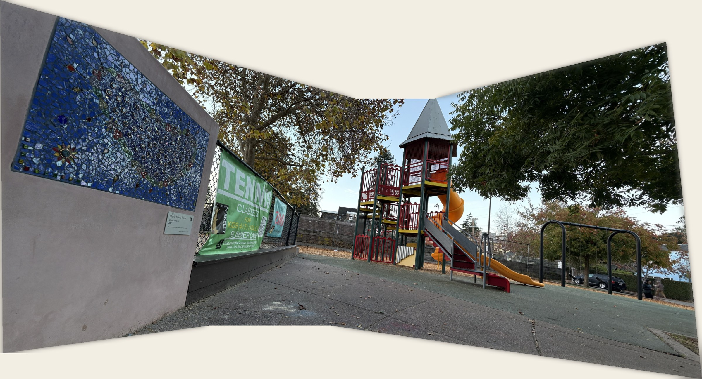
</figure>

##### Playground and a Sandbox
<figure>
  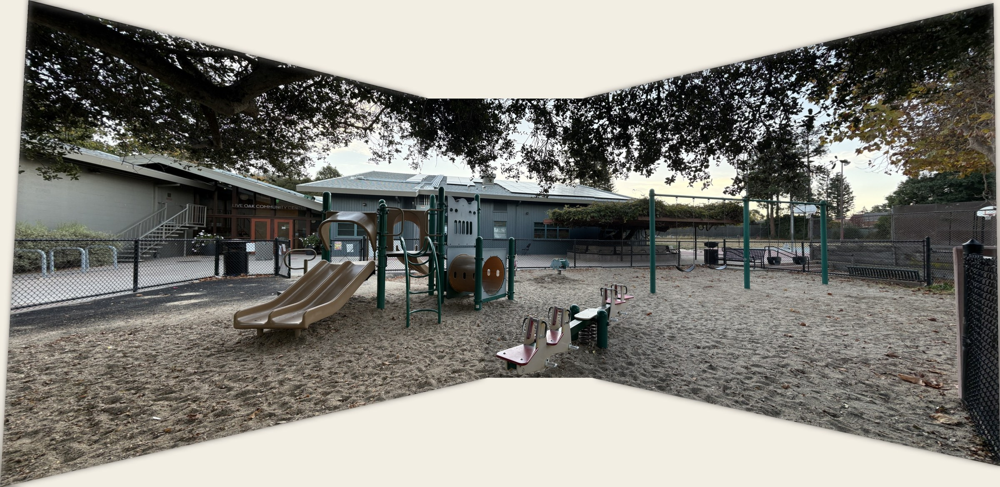
</figure>

##### Pantry
<figure>
  
</figure>

##### Closet
<figure>
  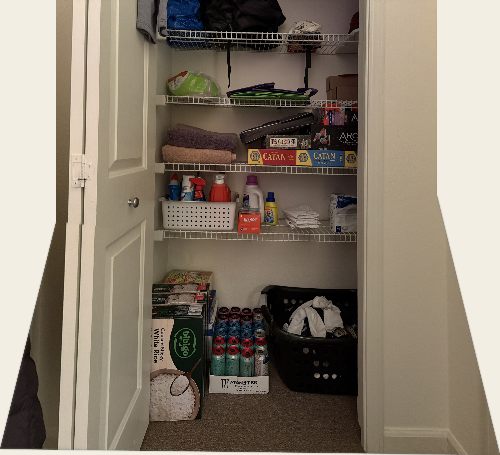
</figure>

##### Deer
<figure>
  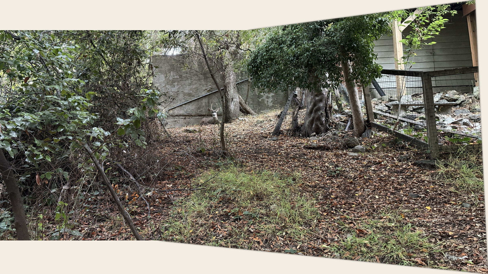
</figure>
